## 1. 引言
### 1.1 实验目的
模拟真实企业架构，用真实设备进行网络搭建
练习内容：MSTP、HSRP、聚合链路、OSPF（完全末梢区域、路由汇总）、BGP、BFD、PPPoE、ACL、IP前缀列表、路由策略、PBR策略路由、IPv6与IPv4通信、单臂路由、IPSec VPN、SSH远程管理、抓包
### 1.2 实验环境
### 1.3 实验设备

| 名称     | 型号              | 图片                                 |
| ------ | --------------- | ---------------------------------- |
| SW1    | 思科Catalyst3560  | 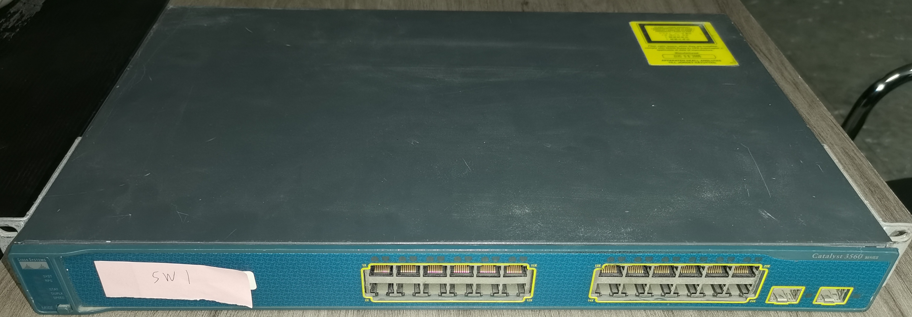    |
| SW2    | 思科Catalyst3560  | 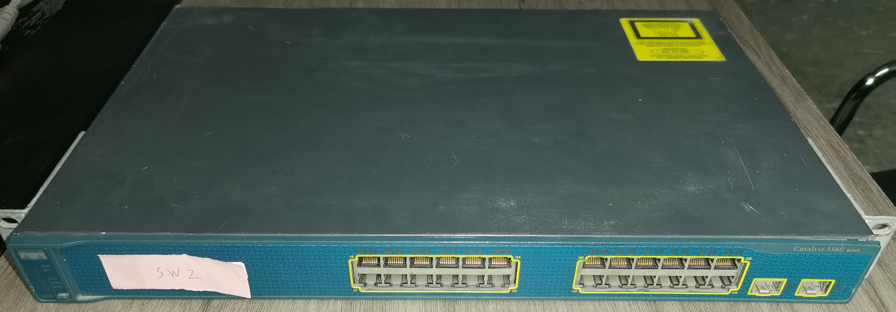    |
| SW3    | 思科Catalyst2960S | 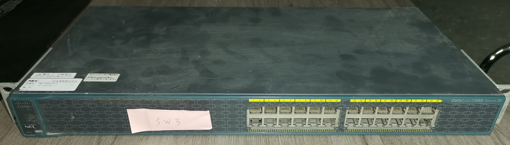    |
| SW4    | 思科Catalyst2960  | 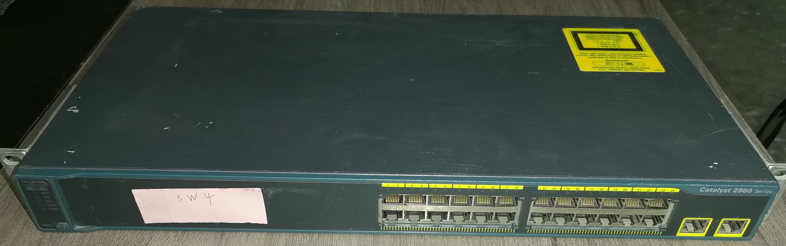    |
| SW5    | 思科Catalyst3550  | 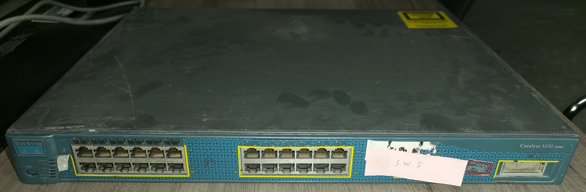    |
| SW6    | 思科Catalyst3560  | 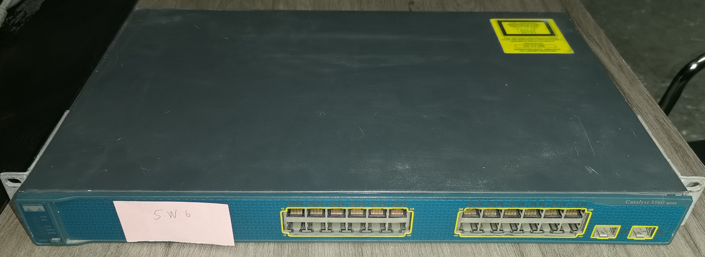    |
| SW7    | 华为Quidway2000   | 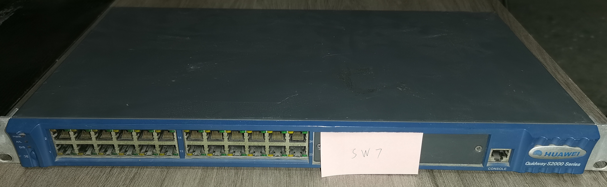    |
| 防火墙    | 思科ASA5505       | 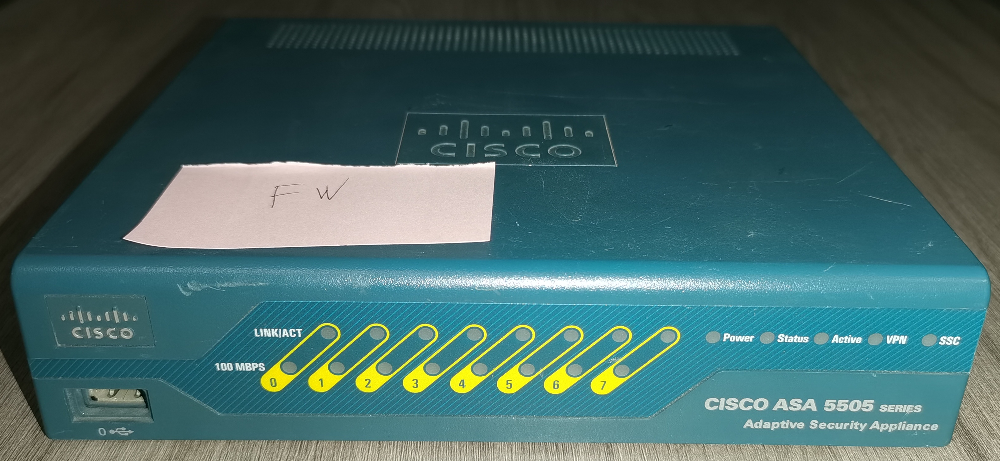     |
| 边界路由R1 | 华为AR2220-S      | 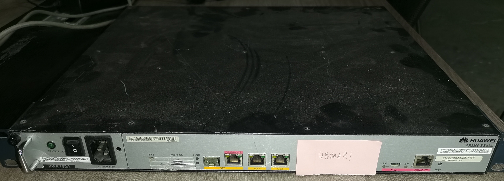 |
| 边界路由R2 | 华为AR28-11       | 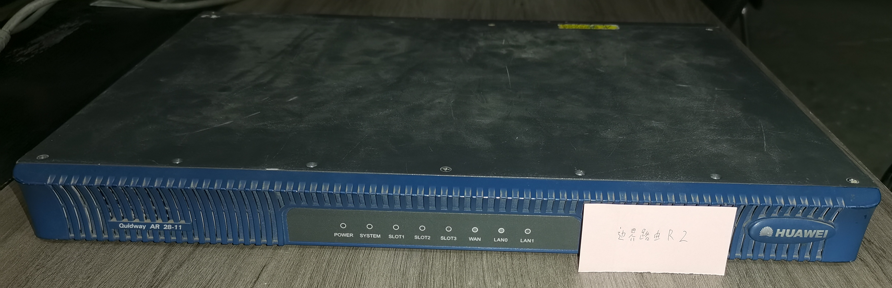 |
| 边界路由R3 | 思科Cisco AR2811  | 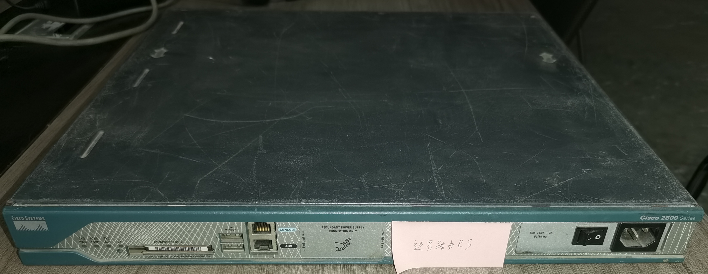 |
| ISP1   | 思科Cisco AR2811  | 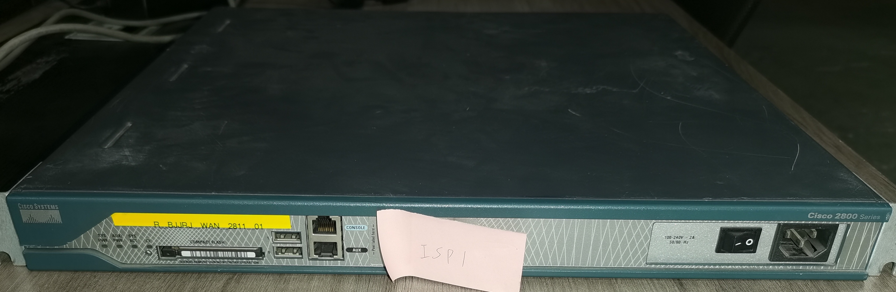   |
| ISP2   | 思科Cisco AR2811  | 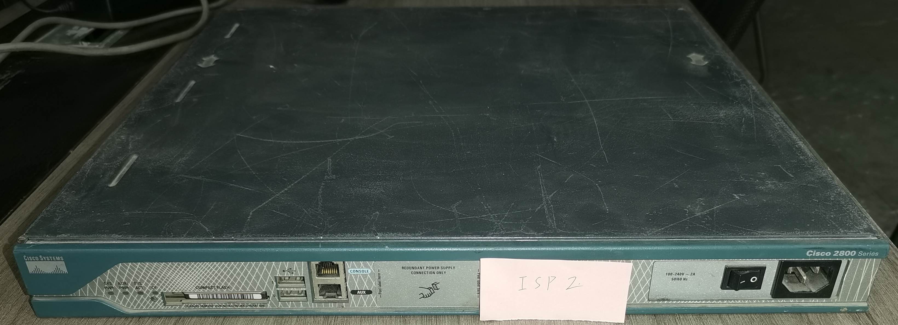   |
### 1.4 目录

- [1. 引言](#1-引言)
	- [1.1 实验目的](#11-实验目的)
	- [1.2 实验环境](#12-实验环境)
	- [1.3 实验设备](#13-实验设备)
	- [1.4 目录](#14-目录)
- [2. 网络拓扑设计](#2-网络拓扑设计)
	- [2.1 网络拓扑图](#21-网络拓扑图)
	- [2.2 网络规划总表](#22-网络规划总表)
- [3. 配置步骤](#3-配置步骤)
	- [3.1 远程管理和基本配置](#31-远程管理和基本配置)
	- [3.2 基本VLAN和IP配置](#32-基本VLAN和IP配置)
	- [3.3 HSRP](#33-HSRP)
	- [3.4 MSTP](#34-MSTP)
	- [3.5 集群](#35-集群)
	- [3.6 DHCP](#36-DHCP)
	- [3.7 OSPF](#37-OSPF)
- [4. 测试验证](#4-测试验证)
	- [4.1 登录测试](#41-登录测试)
	- [4.2 MSTP测试](#42-MSTP测试)
	- [4.3 HSRP切换测试](#43-HSRP切换测试)
	- [4.4 DHCP测试](#44-DHCP测试)
- [5. 问题故障记录](#5-问题故障记录)
	- [5.1 安装镜像](#51-安装镜像)
	- [5.2 MSTP优化](#52-MSTP优化)
	- [5.3 三层交换机开启IP路由功能](#53-三层交换机开启IP路由功能)

## 2. 网络拓扑设计
### 2.1 网络拓扑图
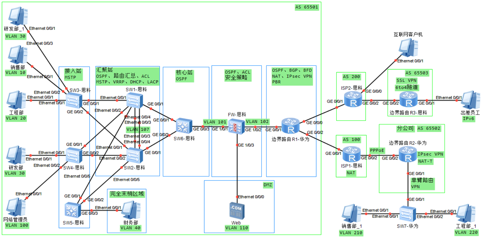
### 2.2 网络规划总表
## 3. 配置步骤

### 3.1 远程管理和基本配置
#### 3.2.1 SW1
```SW1（思科Catalyst3560）
# 配置主机名
Switch>enable    # 进入特权模式
Switch#configure terminal    # 进入全局配置模式
Enter configuration commands, one per line.  End with CNTL/Z.
Switch(config)#no logging console    # 关闭日志屏显
SWitch(config)#vtp mode transparent    # 更改VTP为透明模式（防止出现VLAN覆盖等问题）
Switch(config)#hostname SW1    # 配置主机名
# 配置Console口密码
SW1(config)#line console 0 
SW1(config-line)#password admin123
SW1(config-line)#login    # 开启登录认证（不开启密码配置无效）
SW1(config-line)#exec-timeout 10     # 设置登录超时时间
SW1(config-line)#exit
# 配置进入特权模式密码
SW1(config)#enable secret admin123
# 配置VTY远程登录
SW1(config)#username admin privilege 15 secret admin123    # 创建本地账户用于ssh登录验证
SW1(config)#line vty 0 4    # 进入远程管理vty接口
SW1(config-line)#login local    # 使用本地账户进行登录验证
SW1(config-line)#transport input ssh    # 连接方式为ssh
SW1(config-line)#exec-timeout 10    # 设置登录超时时间为10分钟
SW1(config-line)#exit
SW1(config)#ip domain-name cisco.com    # 配置域名，ssh创建密钥需要有域名才可以
SW1(config)#crypto key generate rsa general-keys modulus 2048    # 创建2048位的RSA密钥
The name for the keys will be: SW1.cisco.com

% The key modulus size is 2048 bits
% Generating 2048 bit RSA keys, keys will be non-exportable...[OK]
```
#### 3.2.2 SW2
```SW2（思科Catalyst3560）
# 配置主机名
Switch>enable
Switch#configure terminal
Enter configuration commands, one per line.  End with CNTL/Z.
Switch(config)#no logging console
SWitch(config)#vtp mode transparent
Switch(config)#hostname SW2
# 配置Console口密码
SW2(config)#line console 0 
SW2(config-line)#password admin123
SW2(config-line)#login
SW2(config-line)#exec-timeout 10
SW2(config-line)#exit
# 配置进入特权模式密码
SW2(config)#enable secret admin123
# 配置VTY远程登陆
SW2(config)#username admin privilege 15 secret admin123
SW2(config)#line vty 0 4
SW2(config-line)#login local 
SW2(config-line)#transport input ssh 
SW2(config-line)#exec-timeout 10 
SW2(config-line)#exit
SW2(config)#ip domain-name cisco.com
SW2(config)#crypto key generate rsa general-keys modulus 2048
The name for the keys will be: SW2.cisco.com

% The key modulus size is 2048 bits
% Generating 2048 bit RSA keys, keys will be non-exportable...[OK]
```
#### 3.2.3 SW3
```SW3（思科Catalyst2960S）
# 配置主机名
Switch>enable
Switch#configure terminal 
Enter configuration commands, one per line.  End with CNTL/Z.
Switch(config)#no logging console
SWitch(config)#vtp mode transparent
Switch(config)#hostname SW3
# 配置默认网关
SW3(config)#ip default-gateway 192.168.99.1 
# 配置VTY远程登陆
SW3(config)#username admin privilege 15 secret admin123
SW3(config)#line vty 0 4
SW3(config-line)#login local
SW3(config-line)#transport input ssh
SW3(config-line)#exec-timeout 10
SW3(config-line)#exit
SW3(config)#ip domain-name cisco.com
SW3(config)#crypto key generate rsa general-keys modulus 2048
The name for the keys will be: SW4.cisco.com

% The key modulus size is 2048 bits
% Generating 2048 bit RSA keys, keys will be non-exportable...[OK]
```
#### 3.2.4 SW4
```SW4（思科Catalyst2960）
# 配置主机名
Switch>enable
Switch#configure terminal 
Enter configuration commands, one per line.  End with CNTL/Z.
Switch(config)#no logging console
SWitch(config)#vtp mode transparent
Switch(config)#hostname SW4
# 配置默认网关
SW4(config)#ip default-gateway 192.168.99.1
# 配置VTY远程登录
SW4(config)#username admin privilege 15 secret admin123
SW4(config)#line vty 0 4
SW4(config-line)#login local
SW4(config-line)#transport input telnet
SW4(config-line)#exec-timeout 10
SW4(config-line)#exit
```
#### 3.2.5 SW5
```SW5（思科Catalyst3550）
# 配置主机名
Switch>enable
Switch#configure terminal 
Enter configuration commands, one per line.  End with CNTL/Z.
Switch(config)#no logging console 
SWitch(config)#vtp mode transparent
Switch(config)#hostname SW5
# 配置默认网关
SW5(config)#ip default-gateway 192.168.99.1
# 配置VTY远程登陆
SW5(config)#username admin privilege 15 secret admin123
SW5(config)#line vty 0 4
SW5(config-line)#login local
SW5(config-line)#transport input telnet    # 由于该交换机IOS版本不支持SSH协议，所以选择telnet方式
SW5(config-line)#exec-timeout 10
SW5(config-line)#exit
```
#### 3.2.6 SW6
```SW6（思科Catalyst3560）
# 配置主机名
Switch>enable
Switch#configure terminal 
Enter configuration commands, one per line.  End with CNTL/Z.
Switch(config)#no logging console
SWitch(config)#vtp mode transparent
Switch(config)#hostname SW6
# 配置VTY远程登录
SW6(config)#username admin privilege 15 secret admin123
SW6(config)#line vty 0 4
SW6(config-line)#login local
SW6(config-line)#transport input ssh
SW6(config-line)#exec-timeout 10
SW6(config-line)#exit
SW6(config)#ip domain-name cisco.com
SW6(config)#crypto key generate rsa general-keys modulus 2048
The name for the keys will be: SW5.cisco.com

% The key modulus size is 2048 bits
% Generating 2048 bit RSA keys, keys will be non-exportable...[OK]
```
### 3.2 基本VLAN和IP配置
// 当前使用Console口连接命令交换机SW2，集群可以很方便的切换到各个成员交换机上。
#### 3.3.1 SW1
```SW1（思科Catalyst 3560）
# 开启IP路由
SW1(config)#ip routing 
# 创建VLAN
SW1(config)#vlan 10,20,30,99,100,107,999
# 配置IP
SW1(config-vlan)#interface vlan 10
SW1(config-if)#ip address 192.168.10.10 255.255.255.0
SW1(config-if)#interface vlan 20
SW1(config-if)#ip address 192.168.20.10 255.255.255.0
SW1(config-if)#interface vlan 30                     
SW1(config-if)#ip address 192.168.30.10 255.255.255.0
SW1(config-if)#interface vlan 99                     
SW1(config-if)#ip address 192.168.99.11 255.255.255.0
SW1(config-if)#interface vlan 100                    
SW1(config-if)#ip address 192.168.100.10 255.255.255.0
SW1(config-if)#interface vlan 107                    
SW1(config-if)#ip address 10.0.107.1 255.255.255.252

# 三层路由口配置IP
SW1(config)#interface f0/3    # 连接SW5
SW1(config-if)#no switchport 
SW1(config-if)#ip address 10.0.105.1 255.255.255.252
SW1(config)#interface f0/13    # 连接SW6
SW1(config-if)#no switchport 
SW1(config-if)#ip address 10.0.103.1 255.255.255.252

# 修改SW1的聚合链路VLAN107的COST值，防止环路
SW1(config-if)#spanning-tree vlan 107 cost 1 

# 配置接口模式并放行/指定VLAN
SW1(config-if)#interface f0/1    # 连接SW3
SW1(config-if)#switchport trunk encapsulation dot1q 
SW1(config-if)#switchport mode trunk 
SW1(config-if)#switchport trunk allowed vlan 10,20,30,99
SW1(config-if)#switchport trunk native vlan 999    # 更改本征VLAN
SW1(config-if)#interface f0/2    # 连接SW4
SW1(config-if)#switchport trunk encapsulation dot1q 
SW1(config-if)#switchport mode trunk 
SW1(config-if)#switchport trunk allowed vlan 30,99,100
SW1(config-if)#switchport trunk native vlan 999
SW1(config-if)exit
SW1(config)#interface range f0/11-12    # 配置聚合链路，连接SW2
SW1(config-if-range)#channel-group 1 mode active 
Creating a port-channel interface Port-channel 1
SW1(config-if-range)#exit
SW1(config)#interface port-channel 1 
SW1(config-if)#switchport trunk encapsulation dot1q 
SW1(config-if)#switchport mode trunk 
SW1(config-if)#switchport trunk allowed vlan 10,20,30,99,100,107
SW1(config-if)#switchport trunk native vlan 999
SW1(config-if)#end
SW1#write memory
Building configuration...
[OK]
```
#### 3.3.2 SW2
```SW2（思科Catalyst3560）
# 开启IP路由
SW2(config)#ip routing 
# 创建VLAN
SW2(config)#vlan 10,20,30,99,100,107,999
# 为需要创建HSRP的VLAN配置IP
SW2(config-vlan)#interface vlan 10
SW2(config-if)#ip address 192.168.10.10 255.255.255.0
SW2(config-if)#interface vlan 20
SW2(config-if)#ip address 192.168.20.10 255.255.255.0
SW2(config-if)#interface vlan 30                     
SW2(config-if)#ip address 192.168.30.10 255.255.255.0
SW2(config-if)#interface vlan 40                     
SW2(config-if)#ip address 192.168.40.10 255.255.255.0
SW2(config-if)#interface vlan 99                     
SW2(config-if)#ip address 192.168.99.12 255.255.255.0
SW2(config-if)#interface vlan 100                    
SW2(config-if)#ip address 192.168.100.10 255.255.255.0
SW2(config-if)#interface vlan 107                    
SW2(config-if)#ip address 10.0.107.2 255.255.255.252

# 三层路由口配置IP
SW2(config)#interface f0/3    # 连接SW5
SW2(config-if)#no switchport 
SW2(config-if)#ip address 10.0.106.1 255.255.255.252
SW2(config)#interface f0/13    # 连接SW6
SW2(config-if)#no switchport 
SW2(config-if)#ip address 10.0.104.1 255.255.255.252

# 配置接口模式并放行/指定VLAN
SW2(config-if)#interface f0/1    # 连接SW3
SW2(config-if)#switchport trunk encapsulation dot1q 
SW2(config-if)#switchport mode trunk 
SW2(config-if)#switchport trunk allowed vlan 10,20,30,99
SW2(config-if)#switchport trunk native vlan 999
SW2(config-if)#interface f0/2    # 连接SW4
SW2(config-if)#switchport trunk encapsulation dot1q 
SW2(config-if)#switchport mode trunk 
SW2(config-if)#switchport trunk allowed vlan 30,99,100
SW2(config-if)#switchport trunk native vlan 999
SW2(config-if)exit
SW2(config)#interface range f0/11-12    # 配置聚合链路，连接SW1
SW2(config-if-range)#channel-group 1 mode active
Creating a port-channel interface Port-channel 1

SW2(config-if-range)#exit
SW2(config)#interface port-channel 1 
SW2(config-if)#switchport trunk encapsulation dot1q 
SW2(config-if)#switchport mode trunk 
SW2(config-if)#switchport trunk allowed vlan 10,20,30,99,100,107
SW2(config-if)#switchport trunk native vlan 999
SW2(config-if)#end
SW2#write memory
Building configuration...
[OK]
```
#### 3.3.3 SW3
```SW3（思科Catalyst2960S）
# 创建VLAN
SW3(config)#vlan 10,20,30,99,999
# 配置管理VLAN
SW3(config-vlan)#interface vlan 99
SW3(config-if)#ip address 192.168.99.13 255.255.255.0
SW3(config-if)#exit
# 配置接口模式并放行/指定VLAN
SW3(config)#interface f0/1    # 连接SW1
SW3(config-if)#switchport mode trunk    # Catalyst2960S不需要设置trunk封装方式，默认就是802.1Q封装
SW3(config-if)#switchport trunk allowed vlan 10,20,30,99
SW3(config-if)#switchport trunk native vlan 999
SW3(config-if)#interface f0/2    # 连接SW2
SW3(config-if)#switchport mode trunk 
SW3(config-if)#switchport trunk allowed vlan 10,20,30,99
SW3(config-if)#switchport trunk native vlan 999
SW3(config-if)#exit
SW3(config)#interface range f0/13-16    # 设置端口组，将F0/11到F0/14四个端口划分给销售部（VLAN 10）（注：端口组在没有定义宏之前只是一个临时视图）
SW3(config-if-range)#switchport mode access 
SW3(config-if-range)#switchport access vlan 10
SW3(config-if-range)#interface range f0/17-20    # 将F0/17到F0/20划分给工程部（VLAN 20）
SW3(config-if-range)#switchport mode access
SW3(config-if-range)#switchport access vlan 20
SW3(config-if-range)#interface range f0/21-24    # 将F0/21到F0/24划分给研发部（VLAN 30）
SW3(config-if-range)#switchport mode access
SW3(config-if-range)#switchport access vlan 30
SW3(config-if-range)#end
SW3#write memory 
Building configuration...
[OK]
```
#### 3.3.4 SW4
```SW4（思科Catalyst2960）
# 创建VLAN
SW4(config)#VLAN 30,99,100,999
# 配置管理VLAN
SW4(config-vlan)#interface vlan 99
SW4(config-if)#ip address 192.168.99.14 255.255.255.0
SW4(config-if)#exit
# 配置接口模式并放行/指定VLAN
SW4(config)#interface f0/1    # 连接SW1
SW4(config-if)#switchport mode trunk    # Catalyst2960不需要设置trunk封装方式，默认就是802.1Q封装
SW4(config-if)#switchport trunk allowed vlan 30,99,100
SW4(config-if)#switchport trunk native vlan 999
SW4(config-if)#interface f0/2    # 连接SW2
SW4(config-if)#switchport mode trunk 
SW4(config-if)#switchport trunk allowed vlan 30,99,100
SW4(config-if)#switchport trunk native vlan 999
SW4(config-if)#exit
SW4(config)#interface range f0/13-16    # 将F0/13到F0/16划分给研发部（VLAN 30）
SW4(config-if-range)#switchport mode access 
SW4(config-if-range)#switchport access vlan 30
SW4(config-if-range)#exit
SW4(config)#interface f0/24    # 划分给管理员所在的VLAN
SW4(config-if)#switchport mode access 
SW4(config-if)#switchport access vlan 100
SW4(config-if)#end
SW4#write memory 
Building configuration...
[OK]
```
#### 3.3.5 SW5
```SW5（思科Catalyst3550）
# 创建VLAN
SW5(config)#VLAN 40,999
# 配置财务部网关IP
SW5(config-vlan)#interface vlan 40
SW5(config-if)#ip address 192.168.40.1 255.255.255.0
# 三层路由口配置IP
SW5(config-if)#interface f0/1    # 连接SW1
SW5(config-if)#no switchport 
SW5(config-if)#ip address 10.0.105.2 255.255.255.252
SW5(config)#interface f0/2    # 连接SW2
SW5(config-if)#no switchport 
SW5(config-if)#ip address 10.0.106.2 255.255.255.252

# 配置接口模式并放行/指定VLAN
SW5(config)#interface range f0/13-16    # 将F0/13到F0/16划分给财务部（VLAN 40）
SW5(config-if-range)#switchport mode access 
SW5(config-if-range)#switchport access vlan 40
SW5(config-if-range)#end
SW5#write memory 
Building configuration...
[OK]
```
#### 3.3.6 SW6
```SW6（思科Catalyst3560）
# 创建VLAN
SW6(config)#vlan 101,999
# 为连接防火墙的VLAN配置IP
SW6(config)#interface vlan 101
SW6(config-if)#ip add 10.0.101.2 255.255.255.252
# 三层路由口配置IP
SW6(config)#interface f0/13    # 连接SW1
SW6(config-if)#no switchport 
SW6(config-if)#ip address 10.0.103.2 255.255.255.252
SW6(config)#interface f0/14    # 连接SW2
SW6(config-if)#no switchport 
SW6(config-if)#ip address 10.0.104.2 255.255.255.252
SW6(config)#interface f0/24    # 连接FW
SW6(config-if)#no switchport
SW6(config-if)#ip address 10.0.101.2 255.255.255.252
SW6(config-if)#end
SW6#write memory 
Building configuration...
[OK]
```
#### 3.3.7 FW
由于没有防火墙的Security Plus许可证，该防火墙只能配置两个安全区域和一个受限区域
ASA 5505防火墙不支持三层功能，只能通过创建VLAN接口方式来配置IP
```FW（思科ASA5505）
# 配置主机名
ciscoasa> enable
Password: 
ciscoasa# configure terminal 
ciscoasa(config)# no logging console 
ciscoasa(config)# hostname FW
# 将接口划分VLAN
FW(config)# interface e0/1    # 连接SW6
FW(config-if)# switchport access vlan 101
FW(config-if)# no shutdown
FW(config-if)# interface e0/2    # 连接R1
FW(config-if)# switchport access vlan 102
FW(config-if)# no shutdown
FW(config-if)# interface e0/3    # 连接服务器
FW(config-if)# switchport access vlan 110
FW(config-if)# no shutdown 
FW(config-if)# exit


# 配置VLAN接口
FW(config)# interface vlan 101
FW(config-if)# nameif inside    # 配置安全区域
INFO: Security level for "inside" set to 100 by default.
FW(config-if)# security-level 100    # 配置安全级别（可省略，inside默认安全级别就是100）
FW(config-if)# ip address 10.0.101.1 255.255.255.252
FW(config-if)# no shutdown 
FW(config-if)# exit
FW(config)# interface vlan 102
FW(config-if)# nameif outside
INFO: Security level for "outside" set to 0 by default.
FW(config-if)# security-level 0    # 可省略，outside默认安全级别就是0
FW(config-if)# ip address 10.0.102.1 255.255.255.252
FW(config-if)# no shutdown 
FW(config-if)# exit
FW(config)# interface vlan 110
FW(config-if)# no forward interface vlan 101    # 受限区域要先配置禁止主动访问VLAN（内网）
FW(config-if)# nameif dmz
INFO: Security level for "dmz" set to 0 by default.
FW(config-if)# security-level 50    # 配置安全级别，默认允许从高级别区域网文低级别区域
FW(config-if)# ip address 172.16.110.1 255.255.255.0 
FW(config-if)# no shutdown
FW(config-if)# exit
```
### 3.3 HSRP
注：该思科交换机Catalyst 3560不支持VRRP。VRRP支持是在IOS版本12.2(58)SE中才被添加到Catalyst 3560系列上的，但是该初代Catalyst3560交换机在12.2(58)SE及之后的版本已不再被支持。所以只能用HSRP来做VRRP的网关冗余效果。
SW1作为VLAN10、VLAN20、VLAN30的Master路由器
SW2作为VLAN99、VLAN100的Master路由器
#### 3.4.1 SW1
```SW1（思科Catalyst3560）
# 配置各VLAN的HSRP
SW1(config)#track 1 interface f0/13 line-protocol    # 创建Track对象用于后续的跟踪
SW1(config-track)#exit
SW1(config)#interface vlan 10
SW1(config-if)#standby 10 ip 192.168.10.1    # 配置虚拟网关IP
SW1(config-if)#standby 10 priority 120    # 配置优先级（默认100，大的优先）
SW1(config-if)#standby 10 preempt delay minimum 10    # 配置抢占延迟10秒
SW1(config-if)#standby 10 track 1 decrement 40    # 配置上行链路跟踪，这里使用之前创建的Track对象ID
SW1(config-if)#interface vlan 20
SW1(config-if)#standby 20 ip 192.168.20.1
SW1(config-if)#standby 20 priority 120
SW1(config-if)#standby 20 preempt delay minimum 10
SW1(config-if)#standby 20 track 1 decrement 40
SW1(config-if)#interface vlan 30
SW1(config-if)#standby 30 ip 192.168.30.1
SW1(config-if)#standby 30 priority 120
SW1(config-if)#standby 30 preempt delay minimum 10
SW1(config-if)#standby 30 track 1 decrement 40
SW1(config-if)#interface vlan 99
SW1(config-if)#standby 99 ip 192.168.99.1
SW1(config-if)#standby 99 preempt    # 思科默认不开启抢占，所以Backup路由器要开一下抢占
SW1(config-if)#standby 99 name Manage_HSRP    # 配置HSRP组名，用于集群绑定
SW1(config-if)#interface vlan 100
SW1(config-if)#standby 100 ip 192.168.100.1
SW1(config-if)#standby 100 preempt
```
#### 3.4.2 SW2
```SW2（思科Catalyst3560）
# 配置各VLAN的HSRP
SW2(config)#track 1 interface f0/13 line-protocol    # 创建Track对象用于后续的跟踪
SW2(config-track)#exit
SW2(config)#interface vlan 10
SW2(config-if)#standby 10 ip 192.168.10.1
SW2(config-if)#standby 10 preempt
SW2(config-if)#interface vlan 20
SW2(config-if)#standby 20 ip 192.168.20.1
SW2(config-if)#standby 20 preempt
SW2(config-if)#interface vlan 30
SW2(config-if)#standby 30 ip 192.168.30.1
SW2(config-if)#standby 30 preempt
SW2(config-if)#interface vlan 99
SW2(config-if)#standby 99 ip 192.168.99.1
SW2(config-if)#standby 99 priority 120
SW2(config-if)#standby 99 preempt delay minimum 10
SW2(config-if)#standby 99 track 1 decrement 40
SW2(config-if)#standby 99 name Manage_HSRP    # 配置HSRP组名，用于集群绑定
SW2(config-if)#interface vlan 100
SW2(config-if)#standby 100 ip 192.168.100.1
SW2(config-if)#standby 100 priority 120
SW2(config-if)#standby 100 preempt delay minimum 10
SW2(config-if)#standby 100 track 1 decrement 40
```
### 3.4 MSTP
SW1作为VLAN10、20、30的根桥
SW2作为VLAN99、100的根桥
SW5和SW6直接用三层路由口与其它交换机相连，不存在二层环路所以不用配置MSTP
#### 3.5.1 SW1
```SW1（思科Catalyst3560）
# 定义MST域
SW1(config)#spanning-tree mst configuration    # 进入域配置视图
SW1(config-mst)#name MSTP    # 域名
SW1(config-mst)#revision 1    # 修订级别
SW1(config-mst)#instance 1 vlan 10,20,30    # 将VLAN10、20、30映射到实例1
SW1(config-mst)#instance 2 vlan 99,100    # 将VLAN99、100映射到实例2
SW1(config-mst)#exit    # 退出就会自动激活域配置
SW1(config)#spanning-tree mst 1 root primary    # 设置SW1为实例1的根网桥
SW1(config)#spanning-tree mst 2 root secondary    # 设置SW1为实例2的备用根网桥
SW1(config)#spanning-tree mode mst    # 启用MSTP模式（触发全网生成树收敛）
# 配置Root Guard根保护
SW1(config)#interface range f0/1-2    # 连接下游交换机的接口上配置根保护
SW1(config-if-range)#spanning-tree guard root 
SW1(config-if-range)#exit
# 配置Loop Guard环路保护
SW1(config)#interface port-channel 1    # 连接SW2的聚合链路上配置环路保护
SW1(config-if)#spanning-tree guard loop 
SW1(config-if)#end
SW1#write memory
Building configuration...
[OK]
```
#### 3.5.2 SW2
```SW2（思科Catalyst3560）
# 定义MST域
SW2(config)#spanning-tree mst configuration
SW2(config-mst)#name MSTP
SW2(config-mst)#revision 1
SW2(config-mst)#instance 1 vlan 10,20,30
SW2(config-mst)#instance 2 vlan 99,100
SW2(config-mst)#exit
SW2(config)#spanning-tree mst 1 root secondary
SW2(config)#spanning-tree mst 2 root primary
SW2(config)#spanning-tree mode mst
# 配置根保护
SW2(config)#int range f0/1-2
SW2(config-if-range)#spanning-tree guard root
SW2(config-if-range)#exit
# 配置环路保护
SW2(config)#interface port-channel 1
SW2(config-if)#spanning-tree guard loop 
SW2(config-if)#end
SW2#write memory 
Building configuration...
[OK]
```
#### 3.5.3 SW3
```SW3（思科Catalyst2960S）
# 定义MST域
SW3(config)#spanning-tree mst configuration 
SW3(config-mst)#name MSTP
SW3(config-mst)#revision 1
SW3(config-mst)#instance 1 vlan 10,20,30
SW3(config-mst)#instance 2 vlan 99,100
SW3(config-mst)#exit
SW3(config)#spanning-tree mode mst
# 在根端口和替代端口上配置环路保护
SW3(config)#interface range f0/1-2
SW3(config-if-range)#spanning-tree guard loop 
SW3(config-if-range)#exit
# 在连接终端的端口上启用PortFast和BPDU Guard（类似华为设备的边缘端口和BPDU保护），配置时会提示警告，仅是用于提醒，不必理会
SW3(config)#interface range f0/13-24
SW3(config-if-range)#spanning-tree portfast 
%Warning: portfast should only be enabled on ports connected to a single
 host. Connecting hubs, concentrators, switches, bridges, etc... to this
 interface  when portfast is enabled, can cause temporary bridging loops.
 Use with CAUTION

%Portfast will be configured in 12 interfaces due to the range command 
 but will only have effect when the interfaces are in a non-trunking mode.
SW3(config-if-range)#spanning-tree bpduguard enable 
SW3(config-if-range)#end
SW3#write memory 
Building configuration...
[OK]
```
#### 3.5.4 SW4
```SW4（思科Catalyst2960）
# 定义MST域
SW4(config)#spanning-tree mst configuration 
SW4(config-mst)#name MSTP
SW4(config-mst)#revision 1
SW4(config-mst)#instance 1 vlan 10,20,30
SW4(config-mst)#instance 2 vlan 99,100
SW4(config-mst)#exit
SW4(config)#spanning-tree mode mst
# 在根端口和替代端口上配置环路保护
SW4(config)#interface range f0/1-2
SW4(config-if-range)#spanning-tree guard loop 
SW4(config-if-range)#exit
# 在连接终端的端口上启用PortFast和BPDU Guard
SW4(config)#interface range f0/13-16,f0/24
SW4(config-if-range)#spanning-tree portfast 
%Warning: portfast should only be enabled on ports connected to a single
 host. Connecting hubs, concentrators, switches, bridges, etc... to this
 interface  when portfast is enabled, can cause temporary bridging loops.
 Use with CAUTION

%Portfast will be configured in 5 interfaces due to the range command 
 but will only have effect when the interfaces are in a non-trunking mode.
SW4(config-if-range)#spanning-tree bpduguard enable
SW4(config-if-range)#end
SW4#write memory
Building configuration...
[OK]
```
#### SW5和SW6
###### 3.5.5 SW5
```SW5（思科Catalyst3550）
# 定义MST域
SW5(config)#spanning-tree mst configuration 
SW5(config-mst)#name MSTP
SW5(config-mst)#revision 1
SW5(config-mst)#instance 1 vlan 10,20,30
SW5(config-mst)#instance 2 vlan 99,100
SW5(config-mst)#exit
SW5(config)#spanning-tree mode mst
# 
在根端口和替代端口上配置环路保护
SW5(config)#interface range f0/1-2
SW5(config-if-range)#spanning-tree guard loop 
SW5(config-if-range)#exit
# 在连接终端的端口上启用PortFast和BPDU Guard
SW5(config)#interface range f0/13-16,f0/24
SW5(config-if-range)#spanning-tree portfast 
%Warning: portfast should only be enabled on ports connected to a single
 host. Connecting hubs, concentrators, switches, bridges, etc... to this
 interface  when portfast is enabled, can cause temporary bridging loops.
 Use with CAUTION

%Portfast has been configured on FastEthernet0/24 but will only
 have effect when the interface is in a non-trunking mode.
SW5(config-if)#spanning-tree bpduguard enable
SW5(config-if)#end
SW5#write memory
Building configuration...
[OK]
```
###### 3.5.6 SW6
```SW6（思科Catalyst3560）
# 定义MST域
SW6(config)#spanning-tree mst configuration 
SW6(config-mst)#name MSTP
SW6(config-mst)#revision 1
SW6(config-mst)#instance 1 vlan 10,20,30
SW6(config-mst)#instance 2 vlan 99,100
SW6(config-mst)#exit
SW6(config)#spanning-tree mode mst
# 在根端口和替代端口上配置环路保护
SW6(config)#interface range f0/13-14
SW6(config-if-range)#spanning-tree guard loop 
SW6(config-if-range)#exit
# 连接防火墙的端口配置PortFast和BPDU保护
SW6(config-if)#spanning-tree portfast 
%Warning: portfast should only be enabled on ports connected to a single
 host. Connecting hubs, concentrators, switches, bridges, etc... to this
 interface  when portfast is enabled, can cause temporary bridging loops.
 Use with CAUTION

%Portfast has been configured on FastEthernet0/24 but will only
 have effect when the interface is in a non-trunking mode.
SW6(config-if)#spanning-tree bpduguard enable 
SW6(config-if)#end
SW6#write memory 
Building configuration...
[OK]
```
### 3.5 集群
思科设备的集群（Cluster）虽然不像华为的堆叠/集群那么强大，但是可以很方便的在命令交换机上快速切换到成员交换机进行配置，很方便。
将SW2配置为集群的命令交换机，SW1配置为集群的备用交换机
#### 3.6.1 SW1、SW3、SW4、SW5、SW6
所有成员交换机启用集群
```SW1（思科Catalyst3560）
SW1(config)#cluster run
```

```SW3（思科Catalyst3550）
SW3(config)#cluster run
```

```SW4（思科Catalyst2960S）
SW4(config)#cluster run
```

```SW5（思科Catalyst3560）
SW5(config)#cluster run
```

```SW6（思科Catalyst2960）
SW6(config)#cluster run
```
#### 3.6.2 SW2
```SW2（思科Catalyst3560）
# 启用集群并添加成员交换机（注：先将其它交换机启用集群）
SW2(config)#cluster enable MyCluster 1    # 开启集群，集群名是“MyCluster”，该交换机编号为1
SW2(config)#end
SW2#show cluster candidates    # 查看自动发现的候选交换机
                                                             |---Upstream---|
MAC Address    Name         Device Type      PortIf  FEC Hops SN PortIf  FEC
0009.b7bf.2380 SW5          Cisco WS-C3550-2 Fa0/3         1   1  Fa0/1        
0018.ba98.9e00 SW1.cisco.co WS-C3560-24TS    Fa0/12    1   1   2  Fa0/11    1  
0018.baab.a580 SW6.cisco.co WS-C3560-24TS    Fa0/13        1   1  Fa0/13       
0019.e71a.1300 SW4          WS-C2960-24TT-L  Fa0/2         1   1  Fa0/24       
fcfb.fb08.3500 SW3.cisco.co WS-C2960-24-S    Fa0/1         1   1  Fa0/2        
SW2#configure terminal 
Enter configuration commands, one per line.  End with CNTL/Z.  
SW2(config)#cluster member 1 mac-address 0018.ba98.9e00 vlan 99    # 逐个添加成员交换机
SW2(config)#cluster member 3 mac-address fcfb.fb08.3500 vlan 99
SW2(config)#cluster member 4 mac-address 0019.e71a.1300 vlan 99
SW2(config)#cluster member 5 mac-address 0009.b7bf.2380 vlan 99
SW2(config)#cluster member 6 mac-address 0018.baab.a580 vlan 99
SW2(config)#end
# 使用HSRP配置集群的备用交换机，将SW1设置为备交换机，SW2设置为主交换机
SW2#show standby brief | include Vl99    # 查看HSRP状态，当前SW2是Active活动路由器
Vl99        99   120 P Active  local           192.168.99.11   192.168.99.1
SW2(config)#cluster standby-group Manage_HSRP routing-redundancy    # 绑定集群并启用路由冗余
SW2#show cluster members    # 查看已添加的成员交换机
                                                |---Upstream---|
SN MAC Address    Name         PortIf FEC Hops   SN PortIf  FEC  State
1  0018.ba98.9e00 SW1.cisco.co Fa0/12   1   1     2  Fa0/12   1   Up   (Standby)
2  001b.2b22.c680 SW2                       0                     Up   (Cmdr)
3  fcfb.fb08.3500 SW3.cisco.co Fa0/2        1     2  Fa0/1        Up  
4  0019.e71a.1300 SW4          Fa0/2        1     2  Fa0/2        Up  
5  0009.b7bf.2380 SW5          Fa0/2        1     2  Fa0/3        Up  
6  0018.baab.a580 SW6.cisco.co Fa0/14       1     2  Fa0/13       Up  
SW2#rcommand 1    # 切换到SW1成员交换机（备用命令交换机）

SW1#show cluster    # 查看集群状态。当前管理IP已改为HSRP的192.168.99.1，且本交换机已经变成了备用交换机
Member switch for cluster "MyCluster"
        Member number:                  1 (Standby command switch)
        Management IP address:		192.168.99.1
        Command switch mac address:     001b.2b22.c680
        Heartbeat interval:             8
        Heartbeat hold-time:            80
SW1#exit

SW2#write memory
Building configuration...
[OK]
```

### 3.6 DHCP
#### 3.7.1 SW1
```SW1（思科Catalyst3560）
# 显示日志
SW1#terminal monitor
# 禁用上行链路端口，触发一次HSRP的Active路由器切换，查看显示的日志
SW1#configure terminal 
Enter configuration commands, one per line.  End with CNTL/Z.
SW1(config)#interface f0/13
SW1(config-if)#shutdown 
SW1(config-if)#
*Mar  5 23:41:17.993: %TRACKING-CLUSTER_MEMBER_1-5-STATE: 1 interface Fa0/13 line-protocol Up->Down    # F0/13端口链路协议状态变为Down
*Mar  5 23:41:18.564: %HSRP-CLUSTER_MEMBER_1-5-STATECHANGE: Vlan10 Grp 10 state Active -> Speak    # VLAN10的HSRP组状态从Active变为Speak
*Mar  5 23:41:19.386: %HSRP-CLUSTER_MEMBER_1-5-STATECHANGE: Vlan20 Grp 20 state Active -> Speak    # VLAN20的HSRP组状态从Active变为Speak
*Mar  5 23:41:19.654: %HSRP-CLUSTER_MEMBER_1-5-STATECHANGE: Vlan30 Grp 30 state Active -> Speak    # VLAN30的HSRP组状态从Active变为Speak
*Mar  5 23:41:19.982: %LINK-CLUSTER_MEMBER_1-5-CHANGED: Interface FastEthernet0/13, changed state to administratively down    # F0/13端口状态变为管理员禁用状态
*Mar  5 23:41:20.988: %LINEPROTO-CLUSTER_MEMBER_1-5-UPDOWN: Line protocol on Interface FastEthernet0/13, changed state to down    # F0/13端口状态变为Down
*Mar  5 23:41:29.847: %HSRP-CLUSTER_MEMBER_1-5-STATECHANGE: Vlan10 Grp 10 state Speak -> Standby    # VLAN10的HSRP组状态从Speak变为Standby
*Mar  5 23:41:30.618: %HSRP-CLUSTER_MEMBER_1-5-STATECHANGE: Vlan30 Grp 30 state Speak -> Standby    # VLAN30的HSRP组状态从Speak变为Standby
*Mar  5 23:41:31.357: %HSRP-CLUSTER_MEMBER_1-5-STATECHANGE: Vlan20 Grp 20 state Speak -> Standby    # VLAN20的HSRP组状态从Speak变为Standby
SW1(config-if)#no shutdown
SW1(config-if)#
# 根据日志配置EEM脚本，在VLAN10的HSRP状态变为Active时创建DHCP地址池
SW1(config)#event manager applet HSRP_VLAN10_DHCP authorization bypass 
SW1(config-applet)#event syslog pattern "%HSRP.*-5-STATECHANGE: Vlan10 Grp 10 state .* -> Active"  
SW1(config-applet)#action 1.0 syslog msg "EEM: VLAN10 ACTIVE - enabling DHCP pool" 
SW1(config-applet)#action 2.0 cli command "enable"
SW1(config-applet)#action 3.0 cli command "configure terminal"
SW1(config-applet)#action 4.0 cli command "ip dhcp excluded-address 192.168.10.1 192.168.10.20"
SW1(config-applet)#action 5.0 cli command "ip dhcp pool VLAN10_POOL"
SW1(config-applet)#action 6.0 cli command "network 192.168.10.0 255.255.255.0"
SW1(config-applet)#action 7.0 cli command "default-router 192.168.10.1"
SW1(config-applet)#action 8.0 cli command "dns-server 8.8.8.8"
SW1(config-applet)#action 9.0 cli command "end"
SW1(config-applet)#exit
# 配置EEM脚本，VLAN10的HSRP状态变为Standby时删除地址池
SW1(config)#event manager applet HSRP_VLAN10_NOT_DHCP authorization bypass 
SW1(config-applet)#event syslog pattern "%HSRP.*-5-STATECHANGE: Vlan10 Grp 10 state Active -> .*"
SW1(config-applet)#action 1.0 syslog msg "EEM: VLAN10 Standby - removing DHCP pool"
SW1(config-applet)#action 2.0 cli command "enable"
SW1(config-applet)#action 3.0 cli command "configure terminal"
SW1(config-applet)#action 4.0 cli command "no ip dhcp pool VLAN10_POOL"
SW1(config-applet)#action 5.0 cli command "end"
SW1(config-applet)#exit

# 在VLAN20的HSRP状态变为Active时创建DHCP地址池
SW1(config)#event manager applet HSRP_VLAN20_DHCP authorization bypass 
SW1(config-applet)#event syslog pattern "%HSRP.*-5-STATECHANGE: Vlan20 Grp 20 state .* -> Active"  
SW1(config-applet)#action 1.0 syslog msg "EEM: VLAN20 ACTIVE - enabling DHCP pool" 
SW1(config-applet)#action 2.0 cli command "enable"
SW1(config-applet)#action 3.0 cli command "configure terminal"
SW1(config-applet)#action 4.0 cli command "ip dhcp excluded-address 192.168.20.1 192.168.20.20"
SW1(config-applet)#action 5.0 cli command "ip dhcp pool VLAN20_POOL"
SW1(config-applet)#action 6.0 cli command "network 192.168.20.0 255.255.255.0"
SW1(config-applet)#action 7.0 cli command "default-router 192.168.20.1"
SW1(config-applet)#action 8.0 cli command "dns-server 8.8.8.8"
SW1(config-applet)#action 9.0 cli command "end"
SW1(config-applet)#exit
# 在VLAN20的HSRP状态变为Standby时删除地址池
SW1(config)#event manager applet HSRP_VLAN20_NOT_DHCP authorization bypass 
SW1(config-applet)#event syslog pattern "%HSRP.*-5-STATECHANGE: Vlan20 Grp 20 state Active -> .*"
SW1(config-applet)#action 1.0 syslog msg "EEM: VLAN20 Standby - removing DHCP pool"
SW1(config-applet)#action 2.0 cli command "enable"
SW1(config-applet)#action 3.0 cli command "configure terminal"
SW1(config-applet)#action 4.0 cli command "no ip dhcp pool VLAN20_POOL"
SW1(config-applet)#action 5.0 cli command "end"
SW1(config-applet)#exit

# 在VLAN30的HSRP状态变为Active时创建DHCP地址池
SW1(config)#event manager applet HSRP_VLAN30_DHCP authorization bypass 
SW1(config-applet)#event syslog pattern "%HSRP.*-5-STATECHANGE: Vlan30 Grp 30 state .* -> Active"  
SW1(config-applet)#action 1.0 syslog msg "EEM: VLAN30 ACTIVE - enabling DHCP pool" 
SW1(config-applet)#action 2.0 cli command "enable"
SW1(config-applet)#action 3.0 cli command "configure terminal"
SW1(config-applet)#action 4.0 cli command "ip dhcp excluded-address 192.168.30.1 192.168.30.20"
SW1(config-applet)#action 5.0 cli command "ip dhcp pool VLAN30_POOL"
SW1(config-applet)#action 6.0 cli command "network 192.168.30.0 255.255.255.0"
SW1(config-applet)#action 7.0 cli command "default-router 192.168.30.1"
SW1(config-applet)#action 8.0 cli command "dns-server 8.8.8.8"
SW1(config-applet)#action 9.0 cli command "end"
SW1(config-applet)#exit
# 在VLAN30的HSRP状态变为Standby时删除地址池
SW1(config)#event manager applet HSRP_VLAN30_NOT_DHCP authorization bypass 
SW1(config-applet)#event syslog pattern "%HSRP.*-5-STATECHANGE: Vlan30 Grp 30 state Active -> .*"
SW1(config-applet)#action 1.0 syslog msg "EEM: VLAN30 Standby - removing DHCP pool"
SW1(config-applet)#action 2.0 cli command "enable"
SW1(config-applet)#action 3.0 cli command "configure terminal"
SW1(config-applet)#action 4.0 cli command "no ip dhcp pool VLAN30_POOL"
SW1(config-applet)#action 5.0 cli command "end"
SW1(config-applet)#exit

# 在VLAN100的HSRP状态变为Active时创建DHCP地址池
SW1(config)#event manager applet HSRP_VLAN100_DHCP authorization bypass 
SW1(config-applet)#event syslog pattern "%HSRP.*-5-STATECHANGE: Vlan100 Grp 100 state .* -> Active"  
SW1(config-applet)#action 1.0 syslog msg "EEM: VLAN100 ACTIVE - enabling DHCP pool" 
SW1(config-applet)#action 2.0 cli command "enable"
SW1(config-applet)#action 3.0 cli command "configure terminal"
SW1(config-applet)#action 4.0 cli command "ip dhcp excluded-address 192.168.100.1 192.168.100.20"
SW1(config-applet)#action 5.0 cli command "ip dhcp pool VLAN100_POOL"
SW1(config-applet)#action 6.0 cli command "network 192.168.100.0 255.255.255.0"
SW1(config-applet)#action 7.0 cli command "default-router 192.168.100.1"
SW1(config-applet)#action 8.0 cli command "dns-server 8.8.8.8"
SW1(config-applet)#action 9.0 cli command "end"
SW1(config-applet)#exit
# 在VLAN100的HSRP状态变为Standby时删除地址池
SW1(config)#event manager applet HSRP_VLAN100_NOT_DHCP authorization bypass 
SW1(config-applet)#event syslog pattern "%HSRP.*-5-STATECHANGE: Vlan100 Grp 100 state Active -> .*"
SW1(config-applet)#action 1.0 syslog msg "EEM: VLAN100 Standby - removing DHCP pool"
SW1(config-applet)#action 2.0 cli command "enable"
SW1(config-applet)#action 3.0 cli command "configure terminal"
SW1(config-applet)#action 4.0 cli command "no ip dhcp pool VLAN100_POOL"
SW1(config-applet)#action 5.0 cli command "end"
SW1(config-applet)#end
SW2#write memory 
Building configuration...
[OK]
```
#### 3.7.2 SW2
```SW2（思科Catalyst3560）
# 显示日志
SW2#terminal monitor 
% Use "logging console" instead    # SW2使用Console线连接中，所以要显示日志需要开启Console登录的日志
SW2#configure terminal 
Enter configuration commands, one per line.  End with CNTL/Z.
SW2(config)#logging console 
# 禁用上行链路端口，触发一次HSRP的Active路由器切换，查看显示的日志
SW2(config)#interface f0/13
SW2(config-if)#shutdown 
SW2(config-if)#
*Mar  6 05:16:04.490: %TRACKING-CLUSTER_MEMBER_2-5-STATE: 1 interface Fa0/13 line-protocol Up->Down
*Mar  6 05:16:04.808: %HSRP-CLUSTER_MEMBER_2-5-STATECHANGE: Vlan40 Grp 40 state Active -> Speak
*Mar  6 05:16:06.344: %HSRP-CLUSTER_MEMBER_2-5-STATECHANGE: Vlan100 Grp 100 state Active -> Speak
*Mar  6 05:16:06.427: %HSRP-CLUSTER_MEMBER_2-5-STATECHANGE: Vlan99 Grp 99 state Active -> Speak
*Mar  6 05:16:06.478: %LINK-CLUSTER_MEMBER_2-5-CHANGED: Interface FastEthernet0/13, changed state to administratively down
*Mar  6 05:16:07.484: %LINEPROTO-CLUSTER_MEMBER_2-5-UPDOWN: Line protocol on Interface FastEthernet0/13, changed state to down
*Mar  6 05:16:16.502: %HSRP-CLUSTER_MEMBER_2-5-STATECHANGE: Vlan40 Grp 40 state Speak -> Standby
*Mar  6 05:16:17.559: %HSRP-CLUSTER_MEMBER_2-5-STATECHANGE: Vlan100 Grp 100 state Speak -> Standby
*Mar  6 05:16:18.297: %HSRP-CLUSTER_MEMBER_2-5-STATECHANGE: Vlan99 Grp 99 state Speak -> Standby
SW2(config-if)#no shutdown
SW2(config-if)#end
# 根据日志配置EEM脚本，在VLAN10的HSRP状态变为Active时创建DHCP地址池
SW2(config)#event manager applet HSRP_VLAN10_DHCP authorization bypass 
SW2(config-applet)#event syslog pattern "%HSRP.*-5-STATECHANGE: Vlan10 Grp 10 state .* -> Active"  
SW2(config-applet)#action 1.0 syslog msg "EEM: VLAN10 ACTIVE - enabling DHCP pool" 
SW2(config-applet)#action 2.0 cli command "enable"
SW2(config-applet)#action 3.0 cli command "configure terminal"
SW2(config-applet)#action 4.0 cli command "ip dhcp excluded-address 192.168.10.1 192.168.10.20"
SW2(config-applet)#action 5.0 cli command "ip dhcp pool VLAN10_POOL"
SW2(config-applet)#action 6.0 cli command "network 192.168.10.0 255.255.255.0"
SW2(config-applet)#action 7.0 cli command "default-router 192.168.10.1"
SW2(config-applet)#action 8.0 cli command "dns-server 8.8.8.8"
SW2(config-applet)#action 9.0 cli command "end"
SW2(config-applet)#exit
# 配置EEM脚本，VLAN10的HSRP状态变为Standby时删除地址池
SW2(config)#event manager applet HSRP_VLAN10_NOT_DHCP authorization bypass 
SW2(config-applet)#event syslog pattern "%HSRP.*-5-STATECHANGE: Vlan10 Grp 10 state Active -> .*"
SW2(config-applet)#action 1.0 syslog msg "EEM: VLAN10 Standby - removing DHCP pool"
SW2(config-applet)#action 2.0 cli command "enable"
SW2(config-applet)#action 3.0 cli command "configure terminal"
SW2(config-applet)#action 4.0 cli command "no ip dhcp pool VLAN10_POOL"
SW2(config-applet)#action 5.0 cli command "end"
SW2(config-applet)#exit

# 在VLAN20的HSRP状态变为Active时创建DHCP地址池
SW2(config)#event manager applet HSRP_VLAN20_DHCP authorization bypass 
SW2(config-applet)#event syslog pattern "%HSRP.*-5-STATECHANGE: Vlan20 Grp 20 state .* -> Active"  
SW2(config-applet)#action 1.0 syslog msg "EEM: VLAN20 ACTIVE - enabling DHCP pool" 
SW2(config-applet)#action 2.0 cli command "enable"
SW2(config-applet)#action 3.0 cli command "configure terminal"
SW2(config-applet)#action 4.0 cli command "ip dhcp excluded-address 192.168.20.1 192.168.20.20"
SW2(config-applet)#action 5.0 cli command "ip dhcp pool VLAN20_POOL"
SW2(config-applet)#action 6.0 cli command "network 192.168.20.0 255.255.255.0"
SW2(config-applet)#action 7.0 cli command "default-router 192.168.20.1"
SW2(config-applet)#action 8.0 cli command "dns-server 8.8.8.8"
SW2(config-applet)#action 9.0 cli command "end"
SW2(config-applet)#exit
# 在VLAN20的HSRP状态变为Standby时删除地址池
SW2(config)#event manager applet HSRP_VLAN20_NOT_DHCP authorization bypass 
SW2(config-applet)#event syslog pattern "%HSRP.*-5-STATECHANGE: Vlan20 Grp 20 state Active -> .*"
SW2(config-applet)#action 1.0 syslog msg "EEM: VLAN20 Standby - removing DHCP pool"
SW2(config-applet)#action 2.0 cli command "enable"
SW2(config-applet)#action 3.0 cli command "configure terminal"
SW2(config-applet)#action 4.0 cli command "no ip dhcp pool VLAN20_POOL"
SW2(config-applet)#action 5.0 cli command "end"
SW2(config-applet)#exit

# 在VLAN30的HSRP状态变为Active时创建DHCP地址池
SW2(config)#event manager applet HSRP_VLAN30_DHCP authorization bypass 
SW2(config-applet)#event syslog pattern "%HSRP.*-5-STATECHANGE: Vlan30 Grp 30 state .* -> Active"  
SW2(config-applet)#action 1.0 syslog msg "EEM: VLAN30 ACTIVE - enabling DHCP pool" 
SW2(config-applet)#action 2.0 cli command "enable"
SW2(config-applet)#action 3.0 cli command "configure terminal"
SW2(config-applet)#action 4.0 cli command "ip dhcp excluded-address 192.168.30.1 192.168.30.20"
SW2(config-applet)#action 5.0 cli command "ip dhcp pool VLAN30_POOL"
SW2(config-applet)#action 6.0 cli command "network 192.168.30.0 255.255.255.0"
SW2(config-applet)#action 7.0 cli command "default-router 192.168.30.1"
SW2(config-applet)#action 8.0 cli command "dns-server 8.8.8.8"
SW2(config-applet)#action 9.0 cli command "end"
SW2(config-applet)#exit
# 在VLAN30的HSRP状态变为Standby时删除地址池
SW2(config)#event manager applet HSRP_VLAN30_NOT_DHCP authorization bypass 
SW2(config-applet)#event syslog pattern "%HSRP.*-5-STATECHANGE: Vlan30 Grp 30 state Active -> .*"
SW2(config-applet)#action 1.0 syslog msg "EEM: VLAN30 Standby - removing DHCP pool"
SW2(config-applet)#action 2.0 cli command "enable"
SW2(config-applet)#action 3.0 cli command "configure terminal"
SW2(config-applet)#action 4.0 cli command "no ip dhcp pool VLAN30_POOL"
SW2(config-applet)#action 5.0 cli command "end"
SW2(config-applet)#exit

# 在VLAN100的HSRP状态变为Active时创建DHCP地址池
SW2(config)#event manager applet HSRP_VLAN100_DHCP authorization bypass 
SW2(config-applet)#event syslog pattern "%HSRP.*-5-STATECHANGE: Vlan100 Grp 100 state .* -> Active"  
SW2(config-applet)#action 1.0 syslog msg "EEM: VLAN100 ACTIVE - enabling DHCP pool" 
SW2(config-applet)#action 2.0 cli command "enable"
SW2(config-applet)#action 3.0 cli command "configure terminal"
SW2(config-applet)#action 4.0 cli command "ip dhcp excluded-address 192.168.100.1 192.168.100.20"
SW2(config-applet)#action 5.0 cli command "ip dhcp pool VLAN100_POOL"
SW2(config-applet)#action 6.0 cli command "network 192.168.100.0 255.255.255.0"
SW2(config-applet)#action 7.0 cli command "default-router 192.168.100.1"
SW2(config-applet)#action 8.0 cli command "dns-server 8.8.8.8"
SW2(config-applet)#action 9.0 cli command "end"
SW2(config-applet)#exit
# 在VLAN100的HSRP状态变为Standby时删除地址池
SW2(config)#event manager applet HSRP_VLAN100_NOT_DHCP authorization bypass 
SW2(config-applet)#event syslog pattern "%HSRP.*-5-STATECHANGE: Vlan100 Grp 100 state Active -> .*"
SW2(config-applet)#action 1.0 syslog msg "EEM: VLAN100 Standby - removing DHCP pool"
SW2(config-applet)#action 2.0 cli command "enable"
SW2(config-applet)#action 3.0 cli command "configure terminal"
SW2(config-applet)#action 4.0 cli command "no ip dhcp pool VLAN100_POOL"
SW2(config-applet)#action 5.0 cli command "end"
SW2(config-applet)#end
SW2#write memory 
Building configuration...
[OK]
```
#### 3.7.3 SW5
SW5作为VLAN40的DHCP服务器
```SW5（思科Catalyst3550）
# 配置DHCP
SW5#configure terminal 
Enter configuration commands, one per line.  End with CNTL/Z.
SW5(config)#service dhcp 
SW5(config)#ip dhcp excluded-address 192.168.40.1 192.168.40.20
SW5(config)#ip dhcp pool VLAN40_POOL
SW5(dhcp-config)#network 192.168.40.0 255.255.255.0
SW5(dhcp-config)#default-router 192.168.40.1 
SW5(dhcp-config)#dns-server 8.8.8.8
SW5(dhcp-config)#exit
```
### 3.7 OSPF
SW1
Area 0：VLAN 103
Area 1：VLAN 10、20、30、100、107
Area 2：VLAN 105
SW2
Area 0：VLAN 104
Area 1：VLAN 10、20、30、100、107
Area 2：VLAN 106
SW5
Area 2：VLAN 40、105、106
SW6
Area 0：VLAN101、103、104
FW
Area 0：VLAN 101、102
Area 3：VLAN 110
边界路由R1
Area 0：G0/0/0
#### 3.8.1 SW1
```SW1（Catalyst3560）
# 配置本地回环地址作为OSPF的Router-id
SW1#configure terminal 
Enter configuration commands, one per line.  End with CNTL/Z.
SW1(config)#interface loopback 0
SW1(config-if)#ip address 1.1.1.1 255.255.255.255
SW1(config-if)#exit
# 配置OSPF
SW1(config)#router ospf 1
SW1(config-router)#router-id 1.1.1.1 
SW1(config-router)#network 10.0.103.0 0.0.0.3 area 0
SW1(config-router)#network 10.0.105.0 0.0.0.3 area 2
SW1(config-router)#network 10.0.107.0 0.0.0.3 area 1
SW1(config-router)#network 192.168.10.0 0.0.0.255 area 1 
SW1(config-router)#network 192.168.20.0 0.0.0.255 area 1
SW1(config-router)#network 192.168.30.0 0.0.0.255 area 1
SW1(config-router)#area 2 stub no-summary    # ABR上指定Area 2为完全末梢区域
SW1(config-router)#passive-interface vlan 10 
SW1(config-router)#passive-interface vlan 20
SW1(config-router)#passive-interface vlan 30
```
#### 3.8.2 SW2
```SW2（思科Catalyst3560）
#
SW2(config)#interface loopback 0
SW2(config-if)#ip address 2.2.2.2 255.255.255.255
SW2(config-if)#exit
# 配置OSPF
SW2(config)#router ospf 1
SW2(config-router)#router-id 2.2.2.2
SW2(config-router)#network 10.0.104.0 0.0.0.3 area 0
SW2(config-router)#network 10.0.106.0 0.0.0.3 area 2
SW2(config-router)#network 10.0.107.0 0.0.0.3 area 1
SW2(config-router)#network 192.168.10.0 0.0.0.255 area 1
SW2(config-router)#network 192.168.20.0 0.0.0.255 area 1
SW2(config-router)#network 192.168.30.0 0.0.0.255 area 1
SW2(config-router)#area 2 stub no-summary 
SW2(config-router)#passive-interface vlan 10
SW2(config-router)#passive-interface vlan 20
SW2(config-router)#passive-interface vlan 30
```
#### 3.8.3 SW5
```SW5（思科Catalyst3550）
# 配置本地回环接口
SW5(config)#interface loopback 0
SW5(config-if)#ip address 5.5.5.5 255.255.255.255
SW5(config-if)#exit
# 配置OSPF
SW5(config)#router ospf 1
SW5(config-router)#router-id 5.5.5.5
SW5(config-router)#network 10.0.105.0 0.0.0.3 area 2
SW5(config-router)#network 10.0.106.0 0.0.0.3 area 2
SW5(config-router)#network 192.168.40.0 0.0.0.255 area 2      
SW5(config-router)#area 2 stub    # IR声明末梢区域
SW5(config-router)#passive-interface vlan 40
```
#### 3.8.4 SW6
```SW6（思科Catalyst3560）
# 配置本地回环地址
SW6(config)#interface loopback 0
SW6(config-if)#ip address 6.6.6.6 255.255.255.255
SW6(config-if)#exit
# 配置OSPF
SW6(config)#router ospf 1
SW6(config-router)#router-id 6.6.6.6
SW6(config-router)#network 10.0.101.0 0.0.0.3 area 0
SW6(config-router)#network 10.0.103.0 0.0.0.3 area 0
SW6(config-router)#network 10.0.104.0 0.0.0.3 area 0
```
#### 3.8.5 FW
```FW（思科ASA5505）
# 配置OSPF
FW(config)# router ospf 1 
FW(config-router)# router-id 7.7.7.7    # ASA5505没有Loopback接口，但支持直接配置Router-id
FW(config-router)# network 10.0.101.0 255.255.255.252 area 0 
FW(config-router)# network 10.0.102.0 255.255.255.252 area 0
FW(config-router)# network 172.16.110.0 255.255.255.0 area 3
FW(config-router)# log-adj-changes 
FW(config-router)# exit
```
## 4. 测试验证
### 4.1 登录测试
以SW1为例
```SW1（思科Catalyst3560）
# 按回车进入并输入Console口密码
SW1 con0 is now available

Press RETURN to get started.

User Access Verification

Password:     # 密码不会显示，输完回车即可
SW1>
SW1>enable
Password:     # 输入进入特权模式的密码
SW1#
```
### 4.2 MSTP测试
#### 4.2.1 检查各交换机的域配置、根网桥、端口角色
```SW1（思科Catalyst3560）
# 检查域配置（所有交换机的域名、修订级别、实例映射必须一致）
SW1#show spanning-tree mst configuration 
Name      [MSTP]    # 域名
Revision  1     Instances configured 3    # 修订级别和实例数

Instance  Vlans mapped    # 实例映射（所有没映射的VLAN默认映射到实例0）
--------  ---------------------------------------------------------------------
0         1-9,11-19,21-29,31-39,41-98,101-4094
1         10,20,30
2         40,99-100
-------------------------------------------------------------------------------
# 检查根网桥和端口角色
SW1#show spanning-tree mst

##### MST0    vlans mapped:   1-9,11-19,21-29,31-39,41-98,101-4094
Bridge        address 0018.ba98.9e00  priority      28672 (28672 sysid 0)
Root          address 001b.2b22.c680  priority      24576 (24576 sysid 0)
              port    Po1             path cost     0        
Regional Root address 001b.2b22.c680  priority      24576 (24576 sysid 0)
                                      internal cost 100000    rem hops 19
Operational   hello time 2 , forward delay 15, max age 20, txholdcount 6 
Configured    hello time 2 , forward delay 15, max age 20, max hops    20

Interface        Role Sts Cost      Prio.Nbr Type
---------------- ---- --- --------- -------- --------------------------------
Fa0/1            Desg FWD 200000    128.3    P2p 
Fa0/2            Desg FWD 200000    128.4    P2p 
Fa0/13           Desg FWD 200000    128.15   P2p 
Fa0/24           Desg FWD 200000    128.26   P2p 
Po1              Root FWD 100000    128.56   P2p 

##### MST1    vlans mapped:   10,20,30
Bridge        address 0018.ba98.9e00  priority      24577 (24576 sysid 1)
Root          this switch for MST1

Interface        Role Sts Cost      Prio.Nbr Type
---------------- ---- --- --------- -------- --------------------------------
Fa0/1            Desg FWD 200000    128.3    P2p 
Fa0/2            Desg FWD 200000    128.4    P2p 
Fa0/13           Desg FWD 200000    128.15   P2p 
Po1              Desg FWD 100000    128.56   P2p 

##### MST2    vlans mapped:   40,99-100
Bridge        address 0018.ba98.9e00  priority      28674 (28672 sysid 2)
Root          address 001b.2b22.c680  priority      24578 (24576 sysid 2)
              port    Po1             cost          100000    rem hops 19

Interface        Role Sts Cost      Prio.Nbr Type
---------------- ---- --- --------- -------- --------------------------------
Fa0/1            Desg FWD 200000    128.3    P2p 
Fa0/2            Desg FWD 200000    128.4    P2p 
Fa0/13           Desg FWD 200000    128.15   P2p 
Fa0/24           Desg FWD 200000    128.26   P2p 
Po1              Root FWD 100000    128.56   P2p 
```


```SW2（思科Catalyst3560）
# 检查域配置
SW2#show spanning-tree mst configuration 
Name      [MSTP]
Revision  1     Instances configured 3

Instance  Vlans mapped
--------  ---------------------------------------------------------------------
0         1-9,11-19,21-29,31-39,41-98,101-4094
1         10,20,30
2         40,99-100
-------------------------------------------------------------------------------         
# 检查根网桥和端口角色
SW2#show spanning-tree mst

##### MST0    vlans mapped:   1-9,11-19,21-29,31-39,41-98,101-4094
Bridge        address 001b.2b22.c680  priority      24576 (24576 sysid 0)
Root          this switch for the CIST
Operational   hello time 2 , forward delay 15, max age 20, txholdcount 6 
Configured    hello time 2 , forward delay 15, max age 20, max hops    20

Interface        Role Sts Cost      Prio.Nbr Type
---------------- ---- --- --------- -------- --------------------------------
Fa0/1            Desg FWD 200000    128.3    P2p 
Fa0/2            Desg FWD 200000    128.4    P2p 
Fa0/13           Desg FWD 200000    128.15   P2p 
Fa0/24           Desg FWD 200000    128.26   P2p 
Po1              Desg FWD 100000    128.56   P2p 

##### MST1    vlans mapped:   10,20,30
Bridge        address 001b.2b22.c680  priority      28673 (28672 sysid 1)
Root          address 0018.ba98.9e00  priority      24577 (24576 sysid 1)
              port    Po1             cost          100000    rem hops 19

Interface        Role Sts Cost      Prio.Nbr Type
---------------- ---- --- --------- -------- --------------------------------
Fa0/1            Desg FWD 200000    128.3    P2p 
Fa0/2            Desg FWD 200000    128.4    P2p 
Fa0/13           Desg FWD 200000    128.15   P2p 
Po1              Root FWD 100000    128.56   P2p 

##### MST2    vlans mapped:   40,99-100
Bridge        address 001b.2b22.c680  priority      24578 (24576 sysid 2)
Root          this switch for MST2

Interface        Role Sts Cost      Prio.Nbr Type
---------------- ---- --- --------- -------- --------------------------------
Fa0/1            Desg FWD 200000    128.3    P2p 
Fa0/2            Desg FWD 200000    128.4    P2p 
Fa0/13           Desg FWD 200000    128.15   P2p 
Fa0/24           Desg FWD 200000    128.26   P2p 
Po1              Desg FWD 100000    128.56   P2p 
```

```SW3（思科Catalyst3550）
# 检查域配置
SW3#show spanning-tree mst configuration 
Name      [MSTP]
Revision  1     Instances configured 3

Instance  Vlans mapped
--------  ---------------------------------------------------------------------
0         1-9,11-19,21-29,31-39,41-98,101-4094
1         10,20,30
2         40,99-100      
# 检查根网桥和端口角色
SW3#show spanning-tree mst

##### MST0    vlans mapped:   1-9,11-19,21-29,31-39,41-98,101-4094
Bridge        address 0009.b7bf.2380  priority      32768 (32768 sysid 0)
Root          address 001b.2b22.c680  priority      24576 (24576 sysid 0)
              port    Fa0/2           path cost     0        
Regional Root address 001b.2b22.c680  priority      24576 (24576 sysid 0)
                                      internal cost 200000    rem hops 19
Operational   hello time 2 , forward delay 15, max age 20, txholdcount 6 
Configured    hello time 2 , forward delay 15, max age 20, max hops    20

Interface        Role Sts Cost      Prio.Nbr Type
---------------- ---- --- --------- -------- --------------------------------
Fa0/1            Altn BLK 200000    128.1    P2p 
Fa0/2            Root FWD 200000    128.2    P2p 

##### MST1    vlans mapped:   10,20,30
Bridge        address 0009.b7bf.2380  priority      32769 (32768 sysid 1)
Root          address 0018.ba98.9e00  priority      24577 (24576 sysid 1)
              port    Fa0/1           cost          200000    rem hops 19

Interface        Role Sts Cost      Prio.Nbr Type
---------------- ---- --- --------- -------- --------------------------------
Fa0/1            Root FWD 200000    128.1    P2p 
Fa0/2            Altn BLK 200000    128.2    P2p 

##### MST2    vlans mapped:   40,99-100
Bridge        address 0009.b7bf.2380  priority      32770 (32768 sysid 2)
Root          address 001b.2b22.c680  priority      24578 (24576 sysid 2)
              port    Fa0/2           cost          200000    rem hops 19

Interface        Role Sts Cost      Prio.Nbr Type
---------------- ---- --- --------- -------- --------------------------------
Fa0/1            Altn BLK 200000    128.1    P2p 
Fa0/2            Root FWD 200000    128.2    P2p 
```

```SW4（思科Catalyst2960S）
# 检查域配置
SW4#show spanning-tree mst configuration 
Name      [MSTP]
Revision  1     Instances configured 3

Instance  Vlans mapped
--------  ---------------------------------------------------------------------
0         1-9,11-19,21-29,31-39,41-98,101-4094
1         10,20,30
2         40,99-100
-------------------------------------------------------------------------------
# 检查根网桥和端口角色
SW4#show spanning-tree mst

##### MST0    vlans mapped:   1-9,11-19,21-29,31-39,41-98,101-4094
Bridge        address fcfb.fb08.3500  priority      32768 (32768 sysid 0)
Root          address 001b.2b22.c680  priority      24576 (24576 sysid 0)
              port    Fa0/2           path cost     0        
Regional Root address 001b.2b22.c680  priority      24576 (24576 sysid 0)
                                      internal cost 200000    rem hops 19
Operational   hello time 2 , forward delay 15, max age 20, txholdcount 6 
Configured    hello time 2 , forward delay 15, max age 20, max hops    20

Interface        Role Sts Cost      Prio.Nbr Type
---------------- ---- --- --------- -------- --------------------------------
Fa0/1            Altn BLK 200000    128.1    P2p 
Fa0/2            Root FWD 200000    128.2    P2p 

##### MST1    vlans mapped:   10,20,30
Bridge        address fcfb.fb08.3500  priority      32769 (32768 sysid 1)
Root          address 0018.ba98.9e00  priority      24577 (24576 sysid 1)
              port    Fa0/1           cost          200000    rem hops 19

Interface        Role Sts Cost      Prio.Nbr Type
---------------- ---- --- --------- -------- --------------------------------
Fa0/1            Root FWD 200000    128.1    P2p 
Fa0/2            Altn BLK 200000    128.2    P2p 

##### MST2    vlans mapped:   40,99-100
Bridge        address fcfb.fb08.3500  priority      32770 (32768 sysid 2)
Root          address 001b.2b22.c680  priority      24578 (24576 sysid 2)
              port    Fa0/2           cost          200000    rem hops 19

Interface        Role Sts Cost      Prio.Nbr Type
---------------- ---- --- --------- -------- --------------------------------
Fa0/1            Altn BLK 200000    128.1    P2p 
Fa0/2            Root FWD 200000    128.2    P2p 
```

```SW5（思科Catalyst3560）
# 检查域配置
SW5#show spanning-tree mst configuration 
Name      [MSTP]
Revision  1     Instances configured 3

Instance  Vlans mapped
--------  ---------------------------------------------------------------------
0         1-9,11-19,21-29,31-39,41-98,101-4094
1         10,20,30
2         40,99-100
-------------------------------------------------------------------------------
# 检查根网桥和端口角色
SW5#show spanning-tree mst               

##### MST0    vlans mapped:   1-9,11-19,21-29,31-39,41-98,101-4094
Bridge        address 0018.baab.a580  priority      32768 (32768 sysid 0)
Root          address 001b.2b22.c680  priority      24576 (24576 sysid 0)
              port    Fa0/14          path cost     0        
Regional Root address 001b.2b22.c680  priority      24576 (24576 sysid 0)
                                      internal cost 200000    rem hops 19
Operational   hello time 2 , forward delay 15, max age 20, txholdcount 6 
Configured    hello time 2 , forward delay 15, max age 20, max hops    20

Interface        Role Sts Cost      Prio.Nbr Type
---------------- ---- --- --------- -------- --------------------------------
Fa0/13           Altn BLK 200000    128.15   P2p 
Fa0/14           Root FWD 200000    128.16   P2p 

##### MST1    vlans mapped:   10,20,30
Bridge        address 0018.baab.a580  priority      32769 (32768 sysid 1)
Root          address 0018.ba98.9e00  priority      24577 (24576 sysid 1)
              port    Fa0/13          cost          200000    rem hops 19

Interface        Role Sts Cost      Prio.Nbr Type
---------------- ---- --- --------- -------- --------------------------------
Fa0/13           Root FWD 200000    128.15   P2p 
Fa0/14           Altn BLK 200000    128.16   P2p 

##### MST2    vlans mapped:   40,99-100
Bridge        address 0018.baab.a580  priority      32770 (32768 sysid 2)
Root          address 001b.2b22.c680  priority      24578 (24576 sysid 2)
              port    Fa0/14          cost          200000    rem hops 19

Interface        Role Sts Cost      Prio.Nbr Type
---------------- ---- --- --------- -------- --------------------------------
Fa0/13           Altn BLK 200000    128.15   P2p 
Fa0/14           Root FWD 200000    128.16   P2p 
```

```SW6（思科Catalyst2960）
# 检查域配置
SW6#show spanning-tree mst configuration 
Name      [MSTP]
Revision  1     Instances configured 3

Instance  Vlans mapped
--------  ---------------------------------------------------------------------
0         1-9,11-19,21-29,31-39,41-98,101-4094
1         10,20,30
2         40,99-100
-------------------------------------------------------------------------------
# 检查根网桥和端口角色
SW6#show spanning-tree mst               

##### MST0    vlans mapped:   1-9,11-19,21-29,31-39,41-98,101-4094
Bridge        address 0019.e71a.1300  priority      32768 (32768 sysid 0)
Root          address 001b.2b22.c680  priority      24576 (24576 sysid 0)
              port    Fa0/2           path cost     0        
Regional Root address 001b.2b22.c680  priority      24576 (24576 sysid 0)
                                      internal cost 200000    rem hops 19
Operational   hello time 2 , forward delay 15, max age 20, txholdcount 6 
Configured    hello time 2 , forward delay 15, max age 20, max hops    20

Interface        Role Sts Cost      Prio.Nbr Type
---------------- ---- --- --------- -------- --------------------------------
Fa0/1            Altn BLK 200000    128.1    P2p 
Fa0/2            Root FWD 200000    128.2    P2p 

##### MST2    vlans mapped:   40,99-100
Bridge        address 0019.e71a.1300  priority      32770 (32768 sysid 2)
Root          address 001b.2b22.c680  priority      24578 (24576 sysid 2)
              port    Fa0/2           cost          200000    rem hops 19

Interface        Role Sts Cost      Prio.Nbr Type
---------------- ---- --- --------- -------- --------------------------------
Fa0/1            Altn BLK 200000    128.1    P2p 
Fa0/2            Root FWD 200000    128.2    P2p 
```


#### 4.2.2 进行故障切换测试
以VLAN 10为例进行测试。一台测试客户机连接到SW3的VLAN 10接口，持续ping网关。当前SW1是VLAN 10的根网桥，流量会从SW3的F0/1端口到SW1的F0/1端口。之后SW1上Down掉F0/1端口，观察流量是否会前往SW2再到SW1
```cmd
# 客户端PC连接SW3的VLAN10端口，并配置好192.168.10.0/24网段的IP
[C:\~]$ ipconfig

Windows IP 配置


以太网适配器 以太网:

   连接特定的 DNS 后缀 . . . . . . . : 
   本地链接 IPv6 地址. . . . . . . . : fe80::1767:fc8b:d22c:ffa5%21
   IPv4 地址 . . . . . . . . . . . . : 192.168.10.100
   子网掩码  . . . . . . . . . . . . : 255.255.255.0
   默认网关. . . . . . . . . . . . . : 192.168.10.1
# 客户机持续ping网关
# 注：刚刚恢复端口时可能没有高延迟的包，而过一段时间（收到TC BPDU后MAC地址表加速老化时间）SW3刷新MAC地址表才出现高延迟包
[C:\~]$ ping -t 192.168.10.1

正在 Ping 192.168.10.1 具有 32 字节的数据:
来自 192.168.10.1 的回复: 字节=32 时间=1ms TTL=255
来自 192.168.10.1 的回复: 字节=32 时间=3ms TTL=255
来自 192.168.10.1 的回复: 字节=32 时间=2ms TTL=255
来自 192.168.10.1 的回复: 字节=32 时间=94ms TTL=255    # SW1上Down掉接口
来自 192.168.10.1 的回复: 字节=32 时间=2ms TTL=255
来自 192.168.10.1 的回复: 字节=32 时间=3ms TTL=255
来自 192.168.10.1 的回复: 字节=32 时间=3ms TTL=255
来自 192.168.10.1 的回复: 字节=32 时间=3ms TTL=255
来自 192.168.10.1 的回复: 字节=32 时间=142ms TTL=255    # SW1上恢复端口
来自 192.168.10.1 的回复: 字节=32 时间=4ms TTL=255
来自 192.168.10.1 的回复: 字节=32 时间=2ms TTL=255
来自 192.168.10.1 的回复: 字节=32 时间=79ms TTL=255
来自 192.168.10.1 的回复: 字节=32 时间=3ms TTL=255
```

```SW3（思科Catalyst2960S）
# 检查端口角色
SW3#show spanning-tree mst 1

##### MST1    vlans mapped:   10,20,30
Bridge        address fcfb.fb08.3500  priority      32769 (32768 sysid 1)
Root          address 0018.ba98.9e00  priority      24577 (24576 sysid 1)
              port    Fa0/1           cost          200000    rem hops 19

Interface        Role Sts Cost      Prio.Nbr Type
---------------- ---- --- --------- -------- --------------------------------
Fa0/1            Root FWD 200000    128.1    P2p    # 连接SW1的端口是根端口
Fa0/2            Altn BLK 200000    128.2    P2p 
Fa0/13           Desg FWD 200000    128.13   P2p Edge 
# SW1上Down掉连接SW3的接口后，再次检查端口角色
SW3#show spanning-tree mst 1

##### MST1    vlans mapped:   10,20,30
Bridge        address fcfb.fb08.3500  priority      32769 (32768 sysid 1)
Root          address 0018.ba98.9e00  priority      24577 (24576 sysid 1)
              port    Fa0/2           cost          300000    rem hops 18

Interface        Role Sts Cost      Prio.Nbr Type
---------------- ---- --- --------- -------- --------------------------------
Fa0/2            Root FWD 200000    128.2    P2p    # 此时连接SW2的端口变为根端口
Fa0/13           Desg FWD 200000    128.13   P2p Edge 
# SW1恢复接口后再次检查端口角色
SW3#show spanning-tree mst 1

##### MST1    vlans mapped:   10,20,30
Bridge        address fcfb.fb08.3500  priority      32769 (32768 sysid 1)
Root          address 0018.ba98.9e00  priority      24577 (24576 sysid 1)
              port    Fa0/1           cost          200000    rem hops 19

Interface        Role Sts Cost      Prio.Nbr Type
---------------- ---- --- --------- -------- --------------------------------
Fa0/1            Root FWD 200000    128.1    P2p    # 连接SW1的端口恢复为根端口
Fa0/2            Altn BLK 200000    128.2    P2p 
Fa0/13           Desg FWD 200000    128.13   P2p Edge 
```

```SW1（思科Catalyst3560）
# SW1上Down掉连接SW3的端口
SW1#configure terminal 
Enter configuration commands, one per line.  End with CNTL/Z.
SW1(config)#interface f0/1
SW1(config-if)#shutdown
# 观察完后再恢复接口
SW1(config-if)#no shutdown 
```
### 4.3 HSRP切换测试
#### 4.3.1 SW1
```SW1（思科Catalyst3560）
# SW1上Down掉上行链路的接口，track跟踪机制触发，SW2成为Active路由器
SW1(config-if)#interface f0/13
SW1(config-if)#shutdown 
SW1(config-if)#end
# 查看HSRP状态，SW1在所有VLAN都成为Standby路由器
SW1#show standby brief 
                     P indicates configured to preempt.
                     |
Interface   Grp  Pri P State   Active          Standby         Virtual IP
Vl10        10   80  P Standby 192.168.10.20   local           192.168.10.1
Vl20        20   80  P Standby 192.168.20.20   local           192.168.20.1
Vl30        30   80  P Standby 192.168.30.20   local           192.168.30.1
Vl40        40   100 P Standby 192.168.40.20   local           192.168.40.1
Vl99        99   60  P Standby 192.168.99.12   local           192.168.99.1
Vl100       100  100 P Standby 192.168.100.20  local           192.168.100.1
# SW1恢复端口
SW1#configure terminal 
Enter configuration commands, one per line.  End with CNTL/Z.
SW1(config)#interface f0/13
SW1(config-if)#no shutdown 
SW1(config-if)#end
# SW1重新成为VLAN10、20、30的Active路由器
SW1#show standby brief 
                     P indicates configured to preempt.
                     |
Interface   Grp  Pri P State   Active          Standby         Virtual IP
Vl10        10   120 P Active  local           unknown         192.168.10.1
Vl20        20   120 P Active  local           unknown         192.168.20.1
Vl30        30   120 P Active  local           unknown         192.168.30.1
Vl40        40   100 P Standby 192.168.40.20   local           192.168.40.1
Vl99        99   100 P Standby 192.168.99.12   local           192.168.99.1
Vl100       100  100 P Standby 192.168.100.20  local           192.168.100.1
```
#### 4.3.2 SW2
```SW2（思科Catalyst3560）
# SW2上Down掉上行链路的接口，track跟踪机制触发，SW1成为Active路由器
SW2(config)#interface f0/13
SW2(config-if)#shutdown
SW2(config-if)#end
# 查看HSRP状态，由于刚刚Down掉马上就查看，HSRP还未重新竞选完毕，所以处于HSRP状态机之一的Speak状态。
SW2#show standby brief
                     P indicates configured to preempt.
                     |
Interface   Grp  Pri P State   Active          Standby         Virtual IP
Vl10        10   100 P Standby 192.168.10.10   local           192.168.10.1
Vl20        20   100 P Standby 192.168.20.10   local           192.168.20.1
Vl30        30   100 P Standby 192.168.30.10   local           192.168.30.1
Vl40        40   80  P Speak   192.168.40.10   unknown         192.168.40.1
Vl99        99   80  P Speak   192.168.99.11   unknown         192.168.99.1
Vl100       100  80  P Speak   192.168.100.10  unknown         192.168.100.1
# 等几秒再次查看，SW2在所有VLAN都成为Standby路由器
SW2#show standby brief
                     P indicates configured to preempt.
                     |
Interface   Grp  Pri P State   Active          Standby         Virtual IP
Vl10        10   100 P Standby 192.168.10.10   local           192.168.10.1
Vl20        20   100 P Standby 192.168.20.10   local           192.168.20.1
Vl30        30   100 P Standby 192.168.30.10   local           192.168.30.1
Vl40        40   80  P Standby 192.168.40.10   local           192.168.40.1
Vl99        99   80  P Standby 192.168.99.11   local           192.168.99.1
Vl100       100  80  P Standby 192.168.100.10  local           192.168.100.1
# SW2恢复端口
SW2#configure terminal 
Enter configuration commands, one per line.  End with CNTL/Z.
SW2(config)#interface f0/13
SW2(config-if)#no shutdown
SW2(config-if)#end
# SW2重新成为VLAN40、99、100的Active路由器
SW2#show standby brief
                     P indicates configured to preempt.
                     |
Interface   Grp  Pri P State   Active          Standby         Virtual IP
Vl10        10   100 P Standby 192.168.10.10   local           192.168.10.1
Vl20        20   100 P Standby 192.168.20.10   local           192.168.20.1
Vl30        30   100 P Standby 192.168.30.10   local           192.168.30.1
Vl40        40   120 P Active  local           unknown         192.168.40.1
Vl99        99   120 P Active  local           unknown         192.168.99.1
Vl100       100  120 P Active  local           unknown         192.168.100.1
```


### 4.4 DHCP测试
#### 4.4.1 测试各个VLAN的客户机自动获取IP地址
VLAN 10
```cmd
[C:\~]$ ipconfig /all

以太网适配器 以太网:

   连接特定的 DNS 后缀 . . . . . . . : 
   描述. . . . . . . . . . . . . . . : Realtek USB GbE Family Controller
   物理地址. . . . . . . . . . . . . : 00-E0-4C-18-51-10
   DHCP 已启用 . . . . . . . . . . . : 是
   自动配置已启用. . . . . . . . . . : 是
   本地链接 IPv6 地址. . . . . . . . : fe80::1767:fc8b:d22c:ffa5%21(首选) 
   IPv4 地址 . . . . . . . . . . . . : 192.168.10.21(首选) 
   子网掩码  . . . . . . . . . . . . : 255.255.255.0
   获得租约的时间  . . . . . . . . . : 2026年11月16日 19:03:05
   租约过期的时间  . . . . . . . . . : 2026年11月17日 19:03:05
   默认网关. . . . . . . . . . . . . : 192.168.10.1
   DHCP 服务器 . . . . . . . . . . . : 192.168.10.10
   DHCPv6 IAID . . . . . . . . . . . : 721477708
   DHCPv6 客户端 DUID  . . . . . . . : 00-01-00-01-31-36-ED-BC-38-D5-7A-F3-5A-19
   DNS 服务器  . . . . . . . . . . . : 8.8.8.8
   TCPIP 上的 NetBIOS  . . . . . . . : 已启用
```
VLAN 20
```cmd
[C:\~]$ ipconfig /all

以太网适配器 以太网:

   连接特定的 DNS 后缀 . . . . . . . : 
   描述. . . . . . . . . . . . . . . : Realtek USB GbE Family Controller
   物理地址. . . . . . . . . . . . . : 00-E0-4C-18-51-10
   DHCP 已启用 . . . . . . . . . . . : 是
   自动配置已启用. . . . . . . . . . : 是
   本地链接 IPv6 地址. . . . . . . . : fe80::1767:fc8b:d22c:ffa5%21(首选) 
   IPv4 地址 . . . . . . . . . . . . : 192.168.20.21(首选) 
   子网掩码  . . . . . . . . . . . . : 255.255.255.0
   获得租约的时间  . . . . . . . . . : 2026年11月16日 19:34:04
   租约过期的时间  . . . . . . . . . : 2026年11月17日 19:34:04
   默认网关. . . . . . . . . . . . . : 192.168.20.1
   DHCP 服务器 . . . . . . . . . . . : 192.168.20.10
   DHCPv6 IAID . . . . . . . . . . . : 721477708
   DHCPv6 客户端 DUID  . . . . . . . : 00-01-00-01-31-36-ED-BC-38-D5-7A-F3-5A-19
   DNS 服务器  . . . . . . . . . . . : 8.8.8.8
   TCPIP 上的 NetBIOS  . . . . . . . : 已启用
```
VLAN 30
```cmd
[C:\~]$ ipconfig /all

以太网适配器 以太网:

   连接特定的 DNS 后缀 . . . . . . . : 
   描述. . . . . . . . . . . . . . . : Realtek USB GbE Family Controller
   物理地址. . . . . . . . . . . . . : 00-E0-4C-18-51-10
   DHCP 已启用 . . . . . . . . . . . : 是
   自动配置已启用. . . . . . . . . . : 是
   本地链接 IPv6 地址. . . . . . . . : fe80::1767:fc8b:d22c:ffa5%21(首选) 
   IPv4 地址 . . . . . . . . . . . . : 192.168.30.21(首选) 
   子网掩码  . . . . . . . . . . . . : 255.255.255.0
   获得租约的时间  . . . . . . . . . : 2026年11月16日 19:36:10
   租约过期的时间  . . . . . . . . . : 2026年11月17日 19:36:10
   默认网关. . . . . . . . . . . . . : 192.168.30.1
   DHCP 服务器 . . . . . . . . . . . : 192.168.30.10
   DHCPv6 IAID . . . . . . . . . . . : 721477708
   DHCPv6 客户端 DUID  . . . . . . . : 00-01-00-01-31-36-ED-BC-38-D5-7A-F3-5A-19
   DNS 服务器  . . . . . . . . . . . : 8.8.8.8
   TCPIP 上的 NetBIOS  . . . . . . . : 已启用
```
VLAN 40
```cmd
[C:\~]$ ipconfig /all

以太网适配器 以太网:

   连接特定的 DNS 后缀 . . . . . . . : 
   描述. . . . . . . . . . . . . . . : Realtek USB GbE Family Controller
   物理地址. . . . . . . . . . . . . : 00-E0-4C-18-51-10
   DHCP 已启用 . . . . . . . . . . . : 是
   自动配置已启用. . . . . . . . . . : 是
   本地链接 IPv6 地址. . . . . . . . : fe80::1767:fc8b:d22c:ffa5%21(首选) 
   IPv4 地址 . . . . . . . . . . . . : 192.168.40.21(首选) 
   子网掩码  . . . . . . . . . . . . : 255.255.255.0
   获得租约的时间  . . . . . . . . . : 2026年11月16日 19:39:26
   租约过期的时间  . . . . . . . . . : 2026年11月17日 19:39:47
   默认网关. . . . . . . . . . . . . : 192.168.40.1
   DHCP 服务器 . . . . . . . . . . . : 192.168.40.20
   DHCPv6 IAID . . . . . . . . . . . : 721477708
   DHCPv6 客户端 DUID  . . . . . . . : 00-01-00-01-31-36-ED-BC-38-D5-7A-F3-5A-19
   DNS 服务器  . . . . . . . . . . . : 8.8.8.8
   TCPIP 上的 NetBIOS  . . . . . . . : 已启用
```
VLAN 100
```cmd
[C:\~]$ ipconfig /all

以太网适配器 以太网:

   连接特定的 DNS 后缀 . . . . . . . : 
   描述. . . . . . . . . . . . . . . : Realtek USB GbE Family Controller
   物理地址. . . . . . . . . . . . . : 00-E0-4C-18-51-10
   DHCP 已启用 . . . . . . . . . . . : 是
   自动配置已启用. . . . . . . . . . : 是
   本地链接 IPv6 地址. . . . . . . . : fe80::1767:fc8b:d22c:ffa5%21(首选) 
   IPv4 地址 . . . . . . . . . . . . : 192.168.100.21(首选) 
   子网掩码  . . . . . . . . . . . . : 255.255.255.0
   获得租约的时间  . . . . . . . . . : 2026年11月16日 19:41:17
   租约过期的时间  . . . . . . . . . : 2026年11月17日 19:41:16
   默认网关. . . . . . . . . . . . . : 192.168.100.1
   DHCP 服务器 . . . . . . . . . . . : 192.168.100.20
   DHCPv6 IAID . . . . . . . . . . . : 721477708
   DHCPv6 客户端 DUID  . . . . . . . : 00-01-00-01-31-36-ED-BC-38-D5-7A-F3-5A-19
   DNS 服务器  . . . . . . . . . . . : 8.8.8.8
   TCPIP 上的 NetBIOS  . . . . . . . : 已启用
```
#### 4.4.2 测试EEM脚本自动删除创建DHCP地址池
```SW1（思科Catalyst3560）
# SW1上Down掉上行链路接口，触发HSRP切换，切换日志触发EEM脚本
SW1(config)#interface f0/13
SW1(config-if)#shutdown
SW1(config-if)#end
SW1#show standby brief    # 检查HSRP状态，都转变为Standby状态
                     P indicates configured to preempt.
                     |
Interface   Grp  Pri P State   Active          Standby         Virtual IP
Vl10        10   80  P Standby 192.168.10.20   local           192.168.10.1
Vl20        20   80  P Standby 192.168.20.20   local           192.168.20.1
Vl30        30   80  P Standby 192.168.30.20   local           192.168.30.1
Vl40        40   100 P Standby 192.168.40.20   local           192.168.40.1
Vl99        99   60  P Standby 192.168.99.12   local           192.168.99.1
Vl100       100  100 P Standby 192.168.100.20  local           192.168.100.1
SW1#show event manager history events    # 查看已运行的脚本
No.  Job Id Proc Status   Time of Event            Event Type         Name
1    21     Actv success  Sat Mar 6 06:14:15 1993  syslog             applet: HSRP_VLAN10_DHCP 
2    22     Actv success  Sat Mar 6 06:14:15 1993  syslog             applet: HSRP_VLAN30_DHCP 
3    23     Actv success  Sat Mar 6 06:14:16 1993  syslog             applet: HSRP_VLAN20_DHCP 
4    24     Actv success  Sat Mar 6 06:15:28 1993  syslog             applet: HSRP_VLAN100_DHCP 
5    25     Actv success  Sat Mar 6 06:15:29 1993  syslog             applet: HSRP_VLAN40_DHCP 
6    26     Actv success  Sat Mar 6 06:16:15 1993  syslog             applet: HSRP_VLAN100_NOT_DHCP 
7    27     Actv success  Sat Mar 6 06:16:16 1993  syslog             applet: HSRP_VLAN40_NOT_DHCP 
8    28     Actv success  Sat Mar 6 06:27:51 1993  syslog             applet: HSRP_VLAN20_NOT_DHCP 
9    29     Actv success  Sat Mar 6 06:27:53 1993  syslog             applet: HSRP_VLAN10_NOT_DHCP 
10   30     Actv success  Sat Mar 6 06:27:54 1993  syslog             applet: HSRP_VLAN30_NOT_DHCP 
SW1#show ip dhcp pool    # 地址池已经删除了

SW1#
```

```SW2（思科Catalyst3560）
# 查看HSRP状态
SW2#show standby brief  
                     P indicates configured to preempt.
                     |
Interface   Grp  Pri P State   Active          Standby         Virtual IP
Vl10        10   100 P Active  local           192.168.10.10   192.168.10.1
Vl20        20   100 P Active  local           192.168.20.10   192.168.20.1
Vl30        30   100 P Active  local           192.168.30.10   192.168.30.1
Vl40        40   120 P Active  local           192.168.40.10   192.168.40.1
Vl99        99   120 P Active  local           192.168.99.11   192.168.99.1
Vl100       100  120 P Active  local           192.168.100.10  192.168.100.1
# 查看已运行的脚本
SW2#show event manager history events 
No.  Job Id Proc Status   Time of Event            Event Type         Name
1    10     Actv success  Sat Mar 6 06:16:56 1993  syslog             applet: HSRP_VLAN10_NOT_DHCP 
2    11     Actv success  Sat Mar 6 06:16:56 1993  syslog             applet: HSRP_VLAN30_NOT_DHCP 
3    12     Actv success  Sat Mar 6 06:16:58 1993  syslog             applet: HSRP_VLAN20_NOT_DHCP 
4    13     Actv success  Sat Mar 6 06:18:09 1993  syslog             applet: HSRP_VLAN100_NOT_DHCP 
5    14     Actv success  Sat Mar 6 06:18:11 1993  syslog             applet: HSRP_VLAN40_NOT_DHCP 
6    15     Actv success  Sat Mar 6 06:18:56 1993  syslog             applet: HSRP_VLAN100_DHCP 
7    16     Actv success  Sat Mar 6 06:18:57 1993  syslog             applet: HSRP_VLAN40_DHCP 
8    17     Actv success  Sat Mar 6 06:30:33 1993  syslog             applet: HSRP_VLAN20_DHCP 
9    18     Actv success  Sat Mar 6 06:30:34 1993  syslog             applet: HSRP_VLAN10_DHCP 
10   19     Actv success  Sat Mar 6 06:30:35 1993  syslog             applet: HSRP_VLAN30_DHCP 
# 查看DHCP地址池
SW2#show ip dhcp pool

Pool VLAN100_POOL :
 Utilization mark (high/low)    : 100 / 0
 Subnet size (first/next)       : 0 / 0 
 Total addresses                : 254
 Leased addresses               : 1
 Excluded addresses             : 20
 Pending event                  : none
 1 subnet is currently in the pool :
 Current index        IP address range                    Leased/Excluded/Total
 192.168.100.22       192.168.100.1    - 192.168.100.254   1     / 20    / 254  

Pool VLAN40_POOL :
 Utilization mark (high/low)    : 100 / 0
 Subnet size (first/next)       : 0 / 0 
 Total addresses                : 254
 Leased addresses               : 1
 Excluded addresses             : 20
 Pending event                  : none
 1 subnet is currently in the pool :
 Current index        IP address range                    Leased/Excluded/Total
 192.168.40.22        192.168.40.1     - 192.168.40.254    1     / 20    / 254  

Pool VLAN20_POOL :
 Utilization mark (high/low)    : 100 / 0
 Subnet size (first/next)       : 0 / 0 
 Total addresses                : 254
 Leased addresses               : 0
 Excluded addresses             : 20
 Pending event                  : none
 1 subnet is currently in the pool :
 Current index        IP address range                    Leased/Excluded/Total
 192.168.20.1         192.168.20.1     - 192.168.20.254    0     / 20    / 254  

Pool VLAN10_POOL :
 Utilization mark (high/low)    : 100 / 0
 Subnet size (first/next)       : 0 / 0 
 Total addresses                : 254
 Leased addresses               : 0
 Excluded addresses             : 20
 Pending event                  : none
 1 subnet is currently in the pool :
 Current index        IP address range                    Leased/Excluded/Total
 192.168.10.1         192.168.10.1     - 192.168.10.254    0     / 20    / 254  

Pool VLAN30_POOL :
 Utilization mark (high/low)    : 100 / 0
 Subnet size (first/next)       : 0 / 0 
 Total addresses                : 254
 Leased addresses               : 0
 Excluded addresses             : 20
 Pending event                  : none
 1 subnet is currently in the pool :
 Current index        IP address range                    Leased/Excluded/Total
 192.168.30.1         192.168.30.1     - 192.168.30.254    0     / 20    / 254  
```

```SW1（思科Catalyst3560）
# 恢复接口
SW1#configure terminal 
Enter configuration commands, one per line.  End with CNTL/Z.
SW1(config)#interface f0/13
SW1(config-if)#no shutdown
SW1(config-if)#end
# 查看HSRP状态
SW1#show standby brief
                     P indicates configured to preempt.
                     |
Interface   Grp  Pri P State   Active          Standby         Virtual IP
Vl10        10   120 P Active  local           192.168.10.20   192.168.10.1
Vl20        20   120 P Active  local           192.168.20.20   192.168.20.1
Vl30        30   120 P Active  local           192.168.30.20   192.168.30.1
Vl40        40   100 P Standby 192.168.40.20   local           192.168.40.1
Vl99        99   100 P Standby 192.168.99.12   local           192.168.99.1
Vl100       100  100 P Standby 192.168.100.20  local           192.168.100.1
# 查看已运行的脚本
SW1#show event manager history events 
No.  Job Id Proc Status   Time of Event            Event Type         Name
1    24     Actv success  Sat Mar 6 06:15:28 1993  syslog             applet: HSRP_VLAN100_DHCP 
2    25     Actv success  Sat Mar 6 06:15:29 1993  syslog             applet: HSRP_VLAN40_DHCP 
3    26     Actv success  Sat Mar 6 06:16:15 1993  syslog             applet: HSRP_VLAN100_NOT_DHCP 
4    27     Actv success  Sat Mar 6 06:16:16 1993  syslog             applet: HSRP_VLAN40_NOT_DHCP 
5    28     Actv success  Sat Mar 6 06:27:51 1993  syslog             applet: HSRP_VLAN20_NOT_DHCP 
6    29     Actv success  Sat Mar 6 06:27:53 1993  syslog             applet: HSRP_VLAN10_NOT_DHCP 
7    30     Actv success  Sat Mar 6 06:27:54 1993  syslog             applet: HSRP_VLAN30_NOT_DHCP 
8    31     Actv success  Sat Mar 6 06:57:41 1993  syslog             applet: HSRP_VLAN20_DHCP 
9    32     Actv success  Sat Mar 6 06:57:42 1993  syslog             applet: HSRP_VLAN10_DHCP 
10   33     Actv success  Sat Mar 6 06:57:44 1993  syslog             applet: HSRP_VLAN30_DHCP 
# 查看DHCP地址池
SW1#show ip dhcp pool

Pool VLAN20_POOL :
 Utilization mark (high/low)    : 100 / 0
 Subnet size (first/next)       : 0 / 0 
 Total addresses                : 254
 Leased addresses               : 0
 Excluded addresses             : 20
 Pending event                  : none
 1 subnet is currently in the pool :
 Current index        IP address range                    Leased/Excluded/Total
 192.168.20.1         192.168.20.1     - 192.168.20.254    0     / 20    / 254  

Pool VLAN10_POOL :
 Utilization mark (high/low)    : 100 / 0
 Subnet size (first/next)       : 0 / 0 
 Total addresses                : 254
 Leased addresses               : 0
 Excluded addresses             : 20
 Pending event                  : none
 1 subnet is currently in the pool :
 Current index        IP address range                    Leased/Excluded/Total
 192.168.10.1         192.168.10.1     - 192.168.10.254    0     / 20    / 254  

Pool VLAN30_POOL :
 Utilization mark (high/low)    : 100 / 0
 Subnet size (first/next)       : 0 / 0 
 Total addresses                : 254
 Leased addresses               : 0
 Excluded addresses             : 20
 Pending event                  : none
 1 subnet is currently in the pool :
 Current index        IP address range                    Leased/Excluded/Total
 192.168.30.1         192.168.30.1     - 192.168.30.254    0     / 20    / 254  
```

```SW2（思科Catalyst3560）
# 再次查看SW2的地址池
SW2#show ip dhcp pool

Pool VLAN100_POOL :
 Utilization mark (high/low)    : 100 / 0
 Subnet size (first/next)       : 0 / 0 
 Total addresses                : 254
 Leased addresses               : 1
 Excluded addresses             : 20
 Pending event                  : none
 1 subnet is currently in the pool :
 Current index        IP address range                    Leased/Excluded/Total
 192.168.100.22       192.168.100.1    - 192.168.100.254   1     / 20    / 254  

Pool VLAN40_POOL :
 Utilization mark (high/low)    : 100 / 0
 Subnet size (first/next)       : 0 / 0 
 Total addresses                : 254
 Leased addresses               : 1
 Excluded addresses             : 20
 Pending event                  : none
 1 subnet is currently in the pool :
 Current index        IP address range                    Leased/Excluded/Total
 192.168.40.22        192.168.40.1     - 192.168.40.254    1     / 20    / 254  
```

#### 4.4.3 测试VLAN间通信
VLAN10和VLAN20间通信
```cmd
[C:\~]$ ipconfig

Windows IP 配置

以太网适配器 以太网:

   连接特定的 DNS 后缀 . . . . . . . : 
   本地链接 IPv6 地址. . . . . . . . : fe80::1767:fc8b:d22c:ffa5%21
   IPv4 地址 . . . . . . . . . . . . : 192.168.20.21
   子网掩码  . . . . . . . . . . . . : 255.255.255.0
   默认网关. . . . . . . . . . . . . : 192.168.20.1
# ping另一台处于VLAN10中的电脑
[C:\~]$ ping 192.168.10.21

正在 Ping 192.168.10.21 具有 32 字节的数据:
来自 192.168.10.21 的回复: 字节=32 时间=1ms TTL=63
来自 192.168.10.21 的回复: 字节=32 时间=2ms TTL=63
来自 192.168.10.21 的回复: 字节=32 时间=2ms TTL=63
来自 192.168.10.21 的回复: 字节=32 时间=2ms TTL=63

192.168.10.21 的 Ping 统计信息:
    数据包: 已发送 = 4，已接收 = 4，丢失 = 0 (0% 丢失)，
往返行程的估计时间(以毫秒为单位):
    最短 = 1ms，最长 = 2ms，平均 = 1ms
```
VLAN 10和VLAN 30之间通信
```cmd
# 查看IP
[C:\~]$ ipconfig

Windows IP 配置

以太网适配器 以太网:

   连接特定的 DNS 后缀 . . . . . . . : 
   本地链接 IPv6 地址. . . . . . . . : fe80::1767:fc8b:d22c:ffa5%21
   IPv4 地址 . . . . . . . . . . . . : 192.168.30.21
   子网掩码  . . . . . . . . . . . . : 255.255.255.0
   默认网关. . . . . . . . . . . . . : 192.168.30.1
# ping处于VLAN10的客户机
[C:\~]$ ping 192.168.10.21

正在 Ping 192.168.10.21 具有 32 字节的数据:
来自 192.168.10.21 的回复: 字节=32 时间=1ms TTL=63
来自 192.168.10.21 的回复: 字节=32 时间=1ms TTL=63
来自 192.168.10.21 的回复: 字节=32 时间=2ms TTL=63
来自 192.168.10.21 的回复: 字节=32 时间=2ms TTL=63

192.168.10.21 的 Ping 统计信息:
    数据包: 已发送 = 4，已接收 = 4，丢失 = 0 (0% 丢失)，
往返行程的估计时间(以毫秒为单位):
    最短 = 1ms，最长 = 2ms，平均 = 1ms
```


## 5. 问题故障记录
### 5.1 安装镜像
#### 5.1.1 思科交换机
由于思科交换机IOS版本过低，不支持LLDP，为了和华为交换机混搭使用需要先升级IOS
目标IOS版本：12.2(55)SE3
当前IOS版本：12.2(25)SEB4
首先用电脑连接一根网线能正常ping通到交换机
```SW1（思科）
# 创建一个管理VLAN，并配置IP、应用到接口上
SW2#configure terminal 
Enter configuration commands, one per line.  End with CNTL/Z.
SW2(config)#vlan 100
SW2(config-vlan)#exit
SW2(config)#interface F0/24
SW2(config-if)#switchport mode access
SW2(config-if)#switchport access vlan 100
SW2(config-if)#switchport access vlan 100 
SW2(config-if)#exit
SW2(config)#interface vlan 100
SW2(config-if)#ip address 192.168.100.2 255.255.255.0
SW2(config-if)#end
# 成功ping通电脑
SW2#ping 192.168.100.100

Type escape sequence to abort.
Sending 5, 100-byte ICMP Echos to 192.168.100.100, timeout is 2 seconds:
!!!!!
Success rate is 100 percent (5/5), round-trip min/avg/max = 1/203/1007 ms
```
电脑上使用Tftpd64搭建TFTP服务器，来备份和下载IOS镜像文件
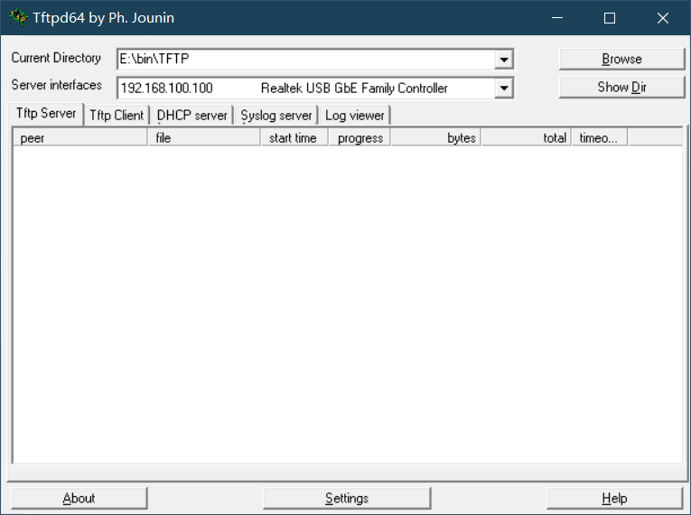
交换机备份原IOS镜像
```SW1（思科）
# 首先查看一下交换机的Flash中有哪些文件
SW2#dir 
Directory of flash:/

    2  -rwx     6398976   Jan 1 1970 03:44:06 +00:00  c3560-ipservices-mz.122-25.SEB4.bin    # 该文件就是交换机的IOS镜像文件
    3  -rwx         736   Mar 1 1993 00:17:15 +00:00  vlan.dat
    4  -rwx        1412   Mar 1 1993 01:38:15 +00:00  config.text
    5  -rwx           5   Mar 1 1993 01:38:15 +00:00  private-config.text

32514048 bytes total (26110976 bytes free)    # 总大小32MB，当前剩余26MB
# 将原IOS镜像上传到TFTP服务器上
SW2#copy flash: tftp: 
Source filename []? c3560-ipservices-mz.122-25.SEB4.bin
Address or name of remote host []? 192.168.100.100
Destination filename [c3560-ipservices-mz.122-25.SEB4.bin]? 
!!!!!!!!!!!!!!!!!!!!!!!!!!!!!!!!!!!!!!!!!!!!!!!!    # 传输中
6398976 bytes copied in 27.044 secs (236614 bytes/sec)
# 备份完成后将新的IOS镜像下载到交换机上
SW2#copy tftp: flash:
Address or name of remote host []? 192.168.100.100
Source filename []? c3560-ipservicesk9-mz.122-55.SE3.bin
Destination filename [c3560-ipservicesk9-mz.122-55.SE3.bin]? 
Accessing tftp://192.168.100.100/c3560-ipservicesk9-mz.122-55.SE3.bin...
Loading c3560-ipservicesk9-mz.122-55.SE3.bin from 192.168.100.100 (via Vlan100): !!!!!!!!!!!!!!!!!!!!!!!!!!!!!!!!!!!!!!!!!!!!!!!!!    # 传输中
[OK - 12748923 bytes]

12748923 bytes copied in 185.103 secs (68875 bytes/sec)
# 查看一下当前Flash中的文件
SW2#dir
Directory of flash:/

    2  -rwx     6398976   Jan 1 1970 03:44:06 +00:00  c3560-ipservices-mz.122-25.SEB4.bin
    3  -rwx         736   Mar 1 1993 00:17:15 +00:00  vlan.dat
    4  -rwx        1412   Mar 1 1993 01:38:15 +00:00  config.text
    5  -rwx           5   Mar 1 1993 01:38:15 +00:00  private-config.text
    6  -rwx    12748923   Mar 1 1993 00:48:22 +00:00  c3560-ipservicesk9-mz.122-55.SE3.bin    # 刚下载的新IOS镜像

32514048 bytes total (13361664 bytes free)
# 将启动文件更改为新的IOS镜像
SW2#configure terminal 
Enter configuration commands, one per line.  End with CNTL/Z.
SW2(config)#no boot system
SW2(config)#boot system flash:c3560-ipservicesk9-mz.122-55.SE3.bin
SW2(config)#end
SW2#write memory    # 保存
Building configuration...
[OK]
SW2#reload    # 重启
Proceed with reload? [confirm]
# 重启后就会开始升级IOS版本
Base ethernet MAC Address: 00:1b:2b:22:c6:80
Xmodem file system is available.
The password-recovery mechanism is enabled.
Initializing Flash...
flashfs[0]: 5 files, 1 directories
flashfs[0]: 0 orphaned files, 0 orphaned directories
flashfs[0]: Total bytes: 32514048
flashfs[0]: Bytes used: 19152896
flashfs[0]: Bytes available: 13361152
flashfs[0]: flashfs fsck took 13 seconds.
...done Initializing Flash.
Boot Sector Filesystem (bs) installed, fsid: 3
done.
Loading "flash:c3560-ipservicesk9-mz.122-55.SE3.bin"...@@@@@@@@@@@@@@@@@@@@@@@@@@@@@@@@@@@@@@@@@@@@@@@@@@@@@@@@@@@@@@@@@@@@@@@@@@@@@@@@@@@@@@@
File "flash:c3560-ipservicesk9-mz.122-55.SE3.bin" uncompressed and installed, entry point: 0x1000000
executing...

              Restricted Rights Legend

Use, duplication, or disclosure by the Government is
subject to restrictions as set forth in subparagraph
(c) of the Commercial Computer Software - Restricted
Rights clause at FAR sec. 52.227-19 and subparagraph
(c) (1) (ii) of the Rights in Technical Data and Computer
Software clause at DFARS sec. 252.227-7013.

           cisco Systems, Inc.
           170 West Tasman Drive
           San Jose, California 95134-1706


Cisco IOS Software, C3560 Software (C3560-IPSERVICESK9-M), Version 12.2(55)SE3, RELEASE SOFTWARE (fc1)
Technical Support: http://www.cisco.com/techsupport
Copyright (c) 1986-2011 by Cisco Systems, Inc.
Compiled Thu 05-May-11 16:14 by prod_rel_team
Image text-base: 0x01000000, data-base: 0x02F00000

Initializing flashfs...

flashfs[1]: 5 files, 1 directories
flashfs[1]: 0 orphaned files, 0 orphaned directories
flashfs[1]: Total bytes: 32514048
flashfs[1]: Bytes used: 19152896
flashfs[1]: Bytes available: 13361152
flashfs[1]: flashfs fsck took 1 seconds.
flashfs[1]: Initialization complete....done Initializing flashfs.

Checking for Bootloader upgrade.. upgrading.. writing boot sectors..done.
The system will now restart
Boot Sector Filesystem (bs) installed, fsid: 2
Base ethernet MAC Address: 00:1b:2b:22:c6:80
Xmodem file system is available.
The password-recovery mechanism is enabled.
Initializing Flash...
flashfs[0]: 5 files, 1 directories
flashfs[0]: 0 orphaned files, 0 orphaned directories
flashfs[0]: Total bytes: 32514048
flashfs[0]: Bytes used: 19152896
flashfs[0]: Bytes available: 13361152
flashfs[0]: flashfs fsck took 14 seconds.
...done Initializing Flash.
done.
Loading "flash:c3560-ipservicesk9-mz.122-55.SE3.bin"...@@@@@@@@@@@@@@@@@@@@@@@@@@@@@@@@@@@@@@@@@@@@@@@@@@@@@@@@@@@@@@@@@@@@@@@@@@@@@@@@@@
File "flash:c3560-ipservicesk9-mz.122-55.SE3.bin" uncompressed and installed, entry point: 0x1000000
executing...

              Restricted Rights Legend

Use, duplication, or disclosure by the Government is
subject to restrictions as set forth in subparagraph
(c) of the Commercial Computer Software - Restricted
Rights clause at FAR sec. 52.227-19 and subparagraph
(c) (1) (ii) of the Rights in Technical Data and Computer
Software clause at DFARS sec. 252.227-7013.

           cisco Systems, Inc.
           170 West Tasman Drive
           San Jose, California 95134-1706


Cisco IOS Software, C3560 Software (C3560-IPSERVICESK9-M), Version 12.2(55)SE3, RELEASE SOFTWARE (fc1)
Technical Support: http://www.cisco.com/techsupport
Copyright (c) 1986-2011 by Cisco Systems, Inc.
Compiled Thu 05-May-11 16:14 by prod_rel_team
Image text-base: 0x01000000, data-base: 0x02F00000

Initializing flashfs...

flashfs[1]: 5 files, 1 directories
flashfs[1]: 0 orphaned files, 0 orphaned directories
flashfs[1]: Total bytes: 32514048
flashfs[1]: Bytes used: 19152896
flashfs[1]: Bytes available: 13361152
flashfs[1]: flashfs fsck took 1 seconds.
flashfs[1]: Initialization complete....done Initializing flashfs.

Checking for Bootloader upgrade.. not needed
POST: CPU MIC register Tests : Begin
POST: CPU MIC register Tests : End, Status Passed

POST: PortASIC Memory Tests : Begin
POST: PortASIC Memory Tests : End, Status Passed

POST: CPU MIC interface Loopback Tests : Begin
POST: CPU MIC interface Loopback Tests : End, Status Passed

POST: PortASIC RingLoopback Tests : Begin
POST: PortASIC RingLoopback Tests : End, Status Passed

POST: PortASIC CAM Subsystem Tests : Begin
POST: PortASIC CAM Subsystem Tests : End, Status Passed

POST: PortASIC Port Loopback Tests : Begin
POST: PortASIC Port Loopback Tests : End, Status Passed

Waiting for Port download...Complete


This product contains cryptographic features and is subject to United
States and local country laws governing import, export, transfer and
use. Delivery of Cisco cryptographic products does not imply
third-party authority to import, export, distribute or use encryption.
Importers, exporters, distributors and users are responsible for
compliance with U.S. and local country laws. By using this product you
agree to comply with applicable laws and regulations. If you are unable
to comply with U.S. and local laws, return this product immediately.

A summary of U.S. laws governing Cisco cryptographic products may be found at:
http://www.cisco.com/wwl/export/crypto/tool/stqrg.html

If you require further assistance please contact us by sending email to
export@cisco.com.

cisco WS-C3560-24TS (PowerPC405) processor (revision D0) with 131072K bytes of memory.
Processor board ID FDO1402X2UC
Last reset from power-on
1 Virtual Ethernet interface
24 FastEthernet interfaces
2 Gigabit Ethernet interfaces
The password-recovery mechanism is enabled.

512K bytes of flash-simulated non-volatile configuration memory.
Base ethernet MAC Address       : 00:1B:2B:22:C6:80
Motherboard assembly number     : 73-9897-06
Power supply part number        : 341-0097-02
Motherboard serial number       : CAT11095FMR
Power supply serial number      : AZS110412DJ
Model revision number           : D0
Motherboard revision number     : A0
Model number                    : WS-C3560-24TS-E
System serial number            : FDO1402X2UC
Top Assembly Part Number        : 800-26160-02
Top Assembly Revision Number    : C0
Version ID                      : V02
CLEI Code Number                : COMMG00ARB
Hardware Board Revision Number  : 0x01


Switch Ports Model              SW Version            SW Image                 
------ ----- -----              ----------            ----------               
*    1 26    WS-C3560-24TS      12.2(55)SE3           C3560-IPSERVICESK9-M     


control-plane
   ^
% Invalid input detected at '^' marker.


Press RETURN to get started!    # 到此已经升级完成并正常重启完毕了，按回车即可

# 查看版本
SW2>enable
SW2#show version
Cisco IOS Software, C3560 Software (C3560-IPSERVICESK9-M), Version 12.2(55)SE3, RELEASE SOFTWARE (fc1)
Technical Support: http://www.cisco.com/techsupport
Copyright (c) 1986-2011 by Cisco Systems, Inc.
Compiled Thu 05-May-11 16:14 by prod_rel_team
Image text-base: 0x01000000, data-base: 0x02F00000

ROM: Bootstrap program is C3560 boot loader
BOOTLDR: C3560 Boot Loader (C3560-HBOOT-M) Version 12.2(44)SE5, RELEASE SOFTWARE (fc1)

SW2 uptime is 2 minutes
System returned to ROM by power-on
System image file is "flash:c3560-ipservicesk9-mz.122-55.SE3.bin"


This product contains cryptographic features and is subject to United
States and local country laws governing import, export, transfer and
use. Delivery of Cisco cryptographic products does not imply
third-party authority to import, export, distribute or use encryption.
Importers, exporters, distributors and users are responsible for
compliance with U.S. and local country laws. By using this product you
agree to comply with applicable laws and regulations. If you are unable
to comply with U.S. and local laws, return this product immediately.

A summary of U.S. laws governing Cisco cryptographic products may be found at:
http://www.cisco.com/wwl/export/crypto/tool/stqrg.html

If you require further assistance please contact us by sending email to
export@cisco.com.

cisco WS-C3560-24TS (PowerPC405) processor (revision D0) with 131072K bytes of memory.
Processor board ID FDO1402X2UC
Last reset from power-on
3 Virtual Ethernet interfaces
24 FastEthernet interfaces
2 Gigabit Ethernet interfaces
The password-recovery mechanism is enabled.

512K bytes of flash-simulated non-volatile configuration memory.
Base ethernet MAC Address       : 00:1B:2B:22:C6:80
Motherboard assembly number     : 73-9897-06
Power supply part number        : 341-0097-02
Motherboard serial number       : CAT11095FMR
Power supply serial number      : AZS110412DJ
Model revision number           : D0
Motherboard revision number     : A0
Model number                    : WS-C3560-24TS-E
System serial number            : FDO1402X2UC
Top Assembly Part Number        : 800-26160-02
Top Assembly Revision Number    : C0
Version ID                      : V02
CLEI Code Number                : COMMG00ARB
Hardware Board Revision Number  : 0x01


Switch Ports Model              SW Version            SW Image                 
------ ----- -----              ----------            ----------               
*    1 26    WS-C3560-24TS      12.2(55)SE3           C3560-IPSERVICESK9-M     


Configuration register is 0xF
# 可以看到SW Version是12.2(55)SE3，已经升级成功
```
#### 5.1.2 思科防火墙
该防火墙启动后不断重启，并提示找不到镜像。所以要安装一个系统镜像。 
```FW（思科）
# 不断循环重启
Launching BootLoader...
Default configuration file contains 1 entry.

Searching / for images to boot.

No images in /
Error 15: File not found    # 提示未找到镜像文件

unable to boot an image


Default configuration file contains 1 entry.

Searching / for images to boot.

No images in /
Error 15: File not found

unable to boot an image


Failsafe booting engaged.
Default configuration file contains 1 entry.

Searching / for images to boot.

No images in /
Error 15: File not found

unable to boot an image


CISCO SYSTEMS 
Embedded BIOS Version 1.0(12)13 08/28/08 15:50:37.45

Low Memory: 632 KB
High Memory: 251 MB
PCI Device Table.
Bus Dev Func VendID DevID Class              Irq
 00  01  00   1022   2080  Host Bridge        
 00  01  02   1022   2082  Chipset En/Decrypt 11
 00  0C  00   1148   4320  Ethernet           11
 00  0D  00   177D   0003  Network En/Decrypt 10
 00  0F  00   1022   2090  ISA Bridge         
 00  0F  02   1022   2092  IDE Controller     
 00  0F  03   1022   2093  Audio              10
 00  0F  04   1022   2094  Serial Bus         9
 00  0F  05   1022   2095  Serial Bus         9

Evaluating BIOS Options ...
Launch BIOS Extension to setup ROMMON

Cisco Systems ROMMON Version (1.0(12)13) #0: Thu Aug 28 15:55:27 PDT 2008

Platform ASA5505

Use BREAK or ESC to interrupt boot.
Use SPACE to begin boot immediately.
Boot in 6 seconds.    # 在十秒倒计时结束之前按ESC进入ROMMON模式
# 进入到ROMMON模式
Ethernet0/0
MAC Address: 0025.8454.c10a
Link is DOWN

Use ? for help.
rommon #1> ADDRESS=192.168.100.1 
rommon #2> SERVER=192.168.100.100
rommon #3> IMAGE=asa821-k8.bin
rommon #4> PORT=Ethernet0/0
Ethernet0/0
MAC Address: 0025.8454.c10a
Link is UP    # 这里插上网线显示链路UP状态
rommon #5> sync

Updating NVRAM Parameters...

rommon #6> ping 192.168.100.100
Sending 20, 100-byte ICMP Echoes to 192.168.100.100, timeout is 4 seconds:
?!!!!!!!!!!!!!!!!!!!
Success rate is 95 percent (19/20)
rommon #7> tftpdnld
ROMMON Variable Settings:
  ADDRESS=192.168.100.1
  SERVER=192.168.100.100
  GATEWAY=0.0.0.0
  PORT=Ethernet0/0
  VLAN=untagged
  IMAGE=asa821-k8.bin
  CONFIG=
  LINKTIMEOUT=20
  PKTTIMEOUT=4
  RETRY=20

tftp asa821-k8.bin@192.168.100.100
!!!!!!!!!!!!!!!!!!!!!!!!!
Received 16275456 bytes

Launching TFTP Image...

Cisco Security Appliance admin loader (3.0) #0: Tue May  5 22:49:28 MDT 2009
Platform ASA5505
Loading...
dosfsck 2.11, 12 Mar 2005, FAT32, LFN
Starting check/repair pass.
Starting verification pass.
/dev/hda1: 8 files, 4/62014 clusters
dosfsck(/dev/hda1) returned 0
Set 'tap0' persistent and owned by uid 0
IO memory 39583744 bytes

Processor memory 142376960, Reserved memory: 41943040 (DSOs: 0 + kernel: 41943040)

Total SSMs found: 0

Total NICs found: 10
88E6095 rev 2 Gigabit Ethernet @ index 09 MAC: 0000.0003.0002
88E6095 rev 2 Ethernet @ index 08 MAC: 0025.8454.c109
88E6095 rev 2 Ethernet @ index 07 MAC: 0025.8454.c108
88E6095 rev 2 Ethernet @ index 06 MAC: 0025.8454.c107
88E6095 rev 2 Ethernet @ index 05 MAC: 0025.8454.c106
88E6095 rev 2 Ethernet @ index 04 MAC: 0025.8454.c105
88E6095 rev 2 Ethernet @ index 03 MAC: 0025.8454.c104
88E6095 rev 2 Ethernet @ index 02 MAC: 0025.8454.c103
88E6095 rev 2 Ethernet @ index 01 MAC: 0025.8454.c102
y88acs06 rev16 Gigabit Ethernet @ index 00 MAC: 0025.8454.c10a
Running Activation Key: 0x00000000 0x00000000 0x00000000 0x00000000 0x00000000 

This activation key is not valid.
Use default settings only

Encryption hardware device : Cisco ASA-5505 on-board accelerator (revision 0x0)
                             Boot microcode   : CN1000-MC-BOOT-2.00 
                             SSL/IKE microcode: CNLite-MC-SSLm-PLUS-2.03
                             IPSec microcode  : CNlite-MC-IPSECm-MAIN-2.04

Cisco Adaptive Security Appliance Software Version 8.2(1) 

  ****************************** Warning *******************************
  This product contains cryptographic features and is
  subject to United States and local country laws
  governing, import, export, transfer, and use.
  Delivery of Cisco cryptographic products does not
  imply third-party authority to import, export,
  distribute, or use encryption. Importers, exporters,
  distributors and users are responsible for compliance
  with U.S. and local country laws. By using this
  product you agree to comply with applicable laws and
  regulations. If you are unable to comply with U.S.
  and local laws, return the enclosed items immediately.

  A summary of U.S. laws governing Cisco cryptographic
  products may be found at:
  http://www.cisco.com/wwl/export/crypto/tool/stqrg.html

  If you require further assistance please contact us by
  sending email to export@cisco.com.
  ******************************* Warning *******************************

Copyright (c) 1996-2009 by Cisco Systems, Inc.

                Restricted Rights Legend

Use, duplication, or disclosure by the Government is
subject to restrictions as set forth in subparagraph
(c) of the Commercial Computer Software - Restricted
Rights clause at FAR sec. 52.227-19 and subparagraph
(c) (1) (ii) of the Rights in Technical Data and Computer
Software clause at DFARS sec. 252.227-7013.

                Cisco Systems, Inc.
                170 West Tasman Drive
                San Jose, California 95134-1706

Type help or '?' for a list of available commands.
ciscoasa> 
# 注意这里是通过tftpdnld引导的，系统是在内存中运行的，需要永久写入到Flash（disk0）中才行
ciscoasa> enable
Password:     # 无密码，直接回车
ciscoasa# dir      

Directory of disk0:/

8      drwx  2048        00:00:52 Jun 30 2014  coredumpinfo
2      drwx  2048        00:33:57 Jan 01 2008  log
7      drwx  2048        00:34:06 Jan 01 2008  crypto_archive

127004672 bytes total (126986240 bytes free)    # 总共128MB
# 注意重启后防火墙没有了之前配置的IP，现在要重新配置一遍
ciscoasa# configure terminal 

ciscoasa(config)# int vlan 100
ciscoasa(config-if)# nameif inside
ciscoasa(config-if)# security-level 100 
ciscoasa(config-if)# ip address 192.168.100.1 255.255.255.0
ciscoasa(config-if)# no shutdown
ciscoasa(config-if)# exit
ciscoasa(config)# interface e0/0 
ciscoasa(config-if)# switchport access vlan 100
ciscoasa(config-if)# no shutdown
ciscoasa(config-if)# end
ciscoasa# ping 192.168.100.100
Type escape sequence to abort.
Sending 5, 100-byte ICMP Echos to 192.168.100.100, timeout is 2 seconds:
!!!!!    # 测试可以ping通
Success rate is 100 percent (5/5), round-trip min/avg/max = 1/2/10 ms
# 开始传输镜像
ciscoasa# copy tftp: disk0:

Address or name of remote host []? 192.168.100.100

Source filename []? asa821-k8.bin

Destination filename [asa821-k8.bin]? 

Accessing tftp://192.168.100.100/asa821-k8.bin...!!!!!!!!!!!!!!!!!
16275456 bytes copied in 48.540 secs (339072 bytes/sec)
ciscoasa# dir                                                                 

Directory of disk0:/

8      drwx  2048        00:00:52 Jun 30 2014  coredumpinfo
2      drwx  2048        00:33:57 Jan 01 2008  log
7      drwx  2048        00:34:06 Jan 01 2008  crypto_archive
11     -rwx  16275456    00:55:48 Jan 01 2008  asa821-k8.bin    # 镜像已经在Flash上了

127004672 bytes total (110710784 bytes free)
ciscoasa# configure terminal 
ciscoasa(config)# boot system disk0:asa821-k8.bin
INFO: Converting disk0:asa821-k8.bin to disk0:/asa821-k8.bin
ciscoasa(config)# write memory
Building configuration...
Cryptochecksum: db1dc5fd 98fb0136 7dbd93af f8275211 

1682 bytes copied in 1.490 secs (1682 bytes/sec)
[OK]
ciscoasa(config)# end
ciscoasa# reload
Proceed with reload? [confirm] 
ciscoasa# 


***
*** --- START GRACEFUL SHUTDOWN ---
Shutting down isakmp
Shutting down File system


***
*** --- SHUTDOWN NOW ---
Process shutdown finished
Rebooting.....Restarting system.


CISCO SYSTEMS 
Embedded BIOS Version 1.0(12)13 08/28/08 15:50:37.45

Low Memory: 632 KB
High Memory: 251 MB
PCI Device Table.
Bus Dev Func VendID DevID Class              Irq
 00  01  00   1022   2080  Host Bridge        
 00  01  02   1022   2082  Chipset En/Decrypt 11
 00  0C  00   1148   4320  Ethernet           11
 00  0D  00   177D   0003  Network En/Decrypt 10
 00  0F  00   1022   2090  ISA Bridge         
 00  0F  02   1022   2092  IDE Controller     
 00  0F  03   1022   2093  Audio              10
 00  0F  04   1022   2094  Serial Bus         9
 00  0F  05   1022   2095  Serial Bus         9

Evaluating BIOS Options ...
Launch BIOS Extension to setup ROMMON

Cisco Systems ROMMON Version (1.0(12)13) #0: Thu Aug 28 15:55:27 PDT 2008

Platform ASA5505

Use BREAK or ESC to interrupt boot.
Use SPACE to begin boot immediately.
                                                
Launching BootLoader...
Boot configuration file contains 1 entry.


Loading disk0:/asa821-k8.bin... Booting...
Platform ASA5505
Loading...
dosfsck 2.11, 12 Mar 2005, FAT32, LFN
Starting check/repair pass.
Starting verification pass.
/dev/hda1: 26 files, 7959/62014 clusters
dosfsck(/dev/hda1) returned 0
Set 'tap0' persistent and owned by uid 0
IO memory 39583744 bytes

Processor memory 142409728, Reserved memory: 41943040 (DSOs: 0 + kernel: 41943040)

Total SSMs found: 0

Total NICs found: 10
88E6095 rev 2 Gigabit Ethernet @ index 09 MAC: 0000.0003.0002
88E6095 rev 2 Ethernet @ index 08 MAC: 0025.8454.c109
88E6095 rev 2 Ethernet @ index 07 MAC: 0025.8454.c108
88E6095 rev 2 Ethernet @ index 06 MAC: 0025.8454.c107
88E6095 rev 2 Ethernet @ index 05 MAC: 0025.8454.c106
88E6095 rev 2 Ethernet @ index 04 MAC: 0025.8454.c105
88E6095 rev 2 Ethernet @ index 03 MAC: 0025.8454.c104
88E6095 rev 2 Ethernet @ index 02 MAC: 0025.8454.c103
88E6095 rev 2 Ethernet @ index 01 MAC: 0025.8454.c102
y88acs06 rev16 Gigabit Ethernet @ index 00 MAC: 0025.8454.c10a
Running Activation Key: 0x00000000 0x00000000 0x00000000 0x00000000 0x00000000 

This activation key is not valid.
Use default settings only

Encryption hardware device : Cisco ASA-5505 on-board accelerator (revision 0x0)
                             Boot microcode   : CN1000-MC-BOOT-2.00 
                             SSL/IKE microcode: CNLite-MC-SSLm-PLUS-2.03
                             IPSec microcode  : CNlite-MC-IPSECm-MAIN-2.04

Cisco Adaptive Security Appliance Software Version 8.2(1) 

  ****************************** Warning *******************************
  This product contains cryptographic features and is
  subject to United States and local country laws
  governing, import, export, transfer, and use.
  Delivery of Cisco cryptographic products does not
  imply third-party authority to import, export,
  distribute, or use encryption. Importers, exporters,
  distributors and users are responsible for compliance
  with U.S. and local country laws. By using this
  product you agree to comply with applicable laws and
  regulations. If you are unable to comply with U.S.
  and local laws, return the enclosed items immediately.

  A summary of U.S. laws governing Cisco cryptographic
  products may be found at:
  http://www.cisco.com/wwl/export/crypto/tool/stqrg.html

  If you require further assistance please contact us by
  sending email to export@cisco.com.
  ******************************* Warning *******************************

Copyright (c) 1996-2009 by Cisco Systems, Inc.

                Restricted Rights Legend

Use, duplication, or disclosure by the Government is
subject to restrictions as set forth in subparagraph
(c) of the Commercial Computer Software - Restricted
Rights clause at FAR sec. 52.227-19 and subparagraph
(c) (1) (ii) of the Rights in Technical Data and Computer
Software clause at DFARS sec. 252.227-7013.

                Cisco Systems, Inc.
                170 West Tasman Drive
                San Jose, California 95134-1706


Cryptochecksum (unchanged): db1dc5fd 98fb0136 7dbd93af f8275211 
Type help or '?' for a list of available commands.
ciscoasa> enable
Password: 
ciscoasa# 


```
#### 5.1.3 华为路由器
华为2220-S路由器，进入BootROM的默认密码：Admin@huawei
```R1（华为AR2220-S）
# 启动镜像丢失导致反复重启
Enter auto startup

Now boot from sd0:/AR2220-S-V200R007C00SPC.cc, please wait...
Open file FAIL!
STUP_OSFileCrcCheck Get file tail fail!
Boot file[sd0:/AR2220-S-V200R007C00SPC.cc] error or not for this device!

Save load state word...OK!

Boot Fail.....................Boot from Backup(Fail) End.
Boot Fail.....................Boot from another Area Begin.
Boot Fail.....................Boot from another Area(Fail) End.
Boot Fail...............................AutoSearch Begin.

!!!NOTE: Auto search packet file and startup!!!


Auto search packet file fail! Please set startup file.
Now boot from sd0:/AR2220-S-V200R007C00SPC.cc, please wait...
Open file FAIL!
STUP_OSFileCrcCheck Get file tail fail!
Boot file[sd0:/AR2220-S-V200R007C00SPC.cc] error or not for this device!

Boot Fail...............................AutoSearch(Fail) END.
Save load state word...OK!

The RollBack Reason : 0x11111111
Boot Fail.......................Reboot to Start to Next Loop. 
BIOS Creation Date : Jan 23 2016, 16:56:01
DDR DRAM init : OK
Start Memory Test ? ('t' or 'T' is test):skip
Copying Data : Done
Uncompressing : Done

Send CMD8 FAIL!

SD Card CMD8: Send Interface Condition FAIL!

SDCard[1] reset fail! 

SDCard[1] Init fail! 
USB2 Host Stack Initialized.
USB Hub Driver Initialized 
USBD  Wind River Systems, Inc. 562 Initialized
Octeon Host Controller Initialize......Done.


Press Ctrl+B to break auto startup ... 2
# 在看到该提示后按Ctrl+B并输入默认密码“Admin@huawei”进入BootROM菜单
Enter Password:************
Default Password,Please Set New Password.


        Main Menu

    1. Default Startup
    2. Serial Menu
    3. Network Menu
    4. Startup Select
    5. File Manager
    6. Reboot
    7. Password Manager
# 查看启动选项
Enter your choice(1-7):4
        Startup Select

    1. Display Startup
    2. Set Boot File
    3. Set Config File
    4. Startupfile Check Manage
    5. Set Startup Waiting Time
    6. return

Enter your choice(0-5):1

************** Current Startup info ****************
Valid Flag State       : Valid
Boot File Name         : sd0:/AR2220-S-V200R007C00SPC.cc    # 启动文件名
Config File Name       : sd0:/vrpcfg.zip
License File Name      : 
Patch File Name        : 
Voice File Name        : 


************** Pre Startup info ********************
Valid Flag State       : Valid
Boot File Name         : 
Config File Name       : 
License File Name      : 
Patch File Name        : 
Voice File Name        : 

        Startup Select

    1. Display Startup
    2. Set Boot File
    3. Set Config File
    4. Startupfile Check Manage
    5. Set Startup Waiting Time
    6. return
# 回到主菜单查看sd0的文件目录
Enter your choice(0-5):0
        Main Menu

    1. Default Startup
    2. Serial Menu
    3. Network Menu
    4. Startup Select
    5. File Manager
    6. Reboot
    7. Password Manager

Enter your choice(1-7):5
        File Menu

    1. Flash file system
    2. SDCard file system
    3. Return

Enter your choice(0-2):2
        SDCard file system MENU

    1. List file in SDCard[1]
    2. Delete file in SDCard[1]
    3. Rename file in SDCard[1]
    4. Format SDCard[1]
    5. Check SDCard[1]
    6. Return

Enter your choice(0-5):1
Files of the device:

0 files found!    # 发现未找到任何文件

        SDCard file system MENU

    1. List file in SDCard[1]
    2. Delete file in SDCard[1]
    3. Rename file in SDCard[1]
    4. Format SDCard[1]
    5. Check SDCard[1]
    6. Return
# 查看Flash文件目录
Enter your choice(0-5):0
        File Menu

    1. Flash file system
    2. SDCard file system
    3. Return

Enter your choice(0-2):1
        Flash file system MENU

    1. List file in flash
    2. Delete file in flash
    3. Rename file in flash
    4. Format Flash file system
    5. Return

Enter your choice(0-4):1    # 没有系统镜像
Directory of flash:/* : 
-rw-     10240  Aug 13 2007 18:38:39   Boot_LogFile
-rw-     22058  Jan 01 1970 00:00:15   evmlog197011
-rw-         0  Jul 09 2019 10:07:11   brdxpon_snmp_cfg.efs
drw-         -  Jul 09 2019 10:09:22   localuser
-rw-       785  Jul 09 2019 10:09:39   default_local.cer

5 files found!
2179072 Byte total, 2031616 Byte free.

        Flash file system MENU

    1. List file in flash
    2. Delete file in flash
    3. Rename file in flash
    4. Format Flash file system
    5. Return
# 查看网络配置，准备使用管理接口连接电脑来下载镜像
Enter your choice(0-4):0
        File Menu

    1. Flash file system
    2. SDCard file system
    3. Return

Enter your choice(0-2):0
        Main Menu

    1. Default Startup
    2. Serial Menu
    3. Network Menu
    4. Startup Select
    5. File Manager
    6. Reboot
    7. Password Manager

Enter your choice(1-7):3
        Network Menu

    8. Display parameter
    9. Modify parameter
    10. Save parameter
    11. Download file
    12. Upload file
    13. Return
# 已有保存过的配置了
Enter your choice(0-5):1

Ftp type            : 1(tftp)
File name           : AR2220-S-V200R007C00SPCc00.cc
Ethernet ip address : 192.168.1.1
Ethernet ip mask    : ffffff00
Gateway ip address  : 
Ftp host ip address : 192.168.1.20    # 电脑作为TFTP服务器的IP
Ftp user            : c02
Ftp password        : ***

        Network Menu

    1. Display parameter
    2. Modify parameter
    3. Save parameter
    4. Download file
    5. Upload file
    6. Return

Enter your choice(0-5):


```
### 5.2 MSTP优化
思科设备默认有mst0，发现mst0的根桥不在汇聚/核心层
```SW2（思科Catalyst3560)
# 查看生成树实例0
SW2#show spanning-tree mst 0

##### MST0    vlans mapped:   1-9,11-19,21-29,31-39,41-98,101-4094
Bridge        address 001b.2b22.c680  priority      32768 (32768 sysid 0)
Root          address 0009.b7bf.2380  priority      32768 (32768 sysid 0)
              port    Fa0/1           path cost     0        
Regional Root address 0009.b7bf.2380  priority      32768 (32768 sysid 0)
                                      internal cost 200000    rem hops 19
Operational   hello time 2 , forward delay 15, max age 20, txholdcount 6 
Configured    hello time 2 , forward delay 15, max age 20, max hops    20

Interface        Role Sts Cost      Prio.Nbr Type
---------------- ---- --- --------- -------- --------------------------------
Fa0/1            Root FWD 200000    128.3    P2p 
Fa0/2            Desg FWD 200000    128.4    P2p 
Fa0/13           Desg FWD 200000    128.15   P2p 
Fa0/24           Desg FWD 200000    128.26   P2p 
Po1              Altn BLK 100000    128.56   P2p 
# Root行显示根桥的MAC地址为0009.b7bf.2380，需要找出该交换机是哪台
# 由于当前已启用集群，可以直接查看集群成员，有显示对应的MAC地址
SW2#show cluster members 
                                                |---Upstream---|
SN MAC Address    Name         PortIf FEC Hops   SN PortIf  FEC  State
1  0018.ba98.9e00 SW1.cisco.co Fa0/12   1   1     2  Fa0/12   1   Up   (Standby)
2  001b.2b22.c680 SW2                       0                     Up   (Cmdr)
3  0009.b7bf.2380 SW3          Fa0/2        1     2  Fa0/1        Up  
4  fcfb.fb08.3500 SW4.cisco.co Fa0/2        1     2  Fa0/2        Up  
5  0018.baab.a580 SW5.cisco.co Fa0/14       1     2  Fa0/13       Up  
6  0019.e71a.1300 SW6          Fa0/2        1     2  Fa0/24       Up  
# 发现MAC地址对应的是SW3，切换到SW3查看确认
SW2#rcommand 3

SW3#show spanning-tree mst 0

##### MST0    vlans mapped:   1-9,11-19,21-29,31-39,41-98,101-4094
Bridge        address 0009.b7bf.2380  priority      32768 (32768 sysid 0)
Root          this switch for the CIST
Operational   hello time 2 , forward delay 15, max age 20, txholdcount 6 
Configured    hello time 2 , forward delay 15, max age 20, max hops    20

Interface        Role Sts Cost      Prio.Nbr Type
---------------- ---- --- --------- -------- --------------------------------
Fa0/1            Desg FWD 200000    128.1    P2p 
Fa0/2            Desg FWD 200000    128.2    P2p 
# 确实显示本交换机是Root交换机。回到SW2和SW1分别配置成根桥和备用根
SW3#exit

SW2#configure terminal 
Enter configuration commands, one per line.  End with CNTL/Z.
SW2(config)#spanning-tree mst 0 root primary 
SW2(config)#end
SW2#rcommand 1

SW1#configure terminal 
Enter configuration commands, one per line.  End with CNTL/Z.
SW1(config)#spanning-tree mst 0 root secondary 
SW1(config)#end
SW1#exit
# 最后验证结果，SW2称为新的根桥
SW2#show spanning-tree mst 0

##### MST0    vlans mapped:   1-9,11-19,21-29,31-39,41-98,101-4094
Bridge        address 001b.2b22.c680  priority      24576 (24576 sysid 0)
Root          this switch for the CIST
Operational   hello time 2 , forward delay 15, max age 20, txholdcount 6 
Configured    hello time 2 , forward delay 15, max age 20, max hops    20

Interface        Role Sts Cost      Prio.Nbr Type
---------------- ---- --- --------- -------- --------------------------------
Fa0/1            Desg FWD 200000    128.3    P2p 
Fa0/2            Desg FWD 200000    128.4    P2p 
Fa0/13           Desg FWD 200000    128.15   P2p 
Fa0/24           Desg FWD 200000    128.26   P2p 
Po1              Desg FWD 100000    128.56   P2p 


```
### 5.3 三层交换机开启IP路由功能
做跨VLAN通信测试时，处于VLAN10和VLAN20的两台客户机各自获取到了DHCP分发的IP。也都能ping通网关。但是却无法互相ping对方。
```cmd
# VLAN20客户机ping网关
[C:\~]$ ping 192.168.20.1

正在 Ping 192.168.20.1 具有 32 字节的数据:
来自 192.168.20.1 的回复: 字节=32 时间=1ms TTL=255
来自 192.168.20.1 的回复: 字节=32 时间=2ms TTL=255

192.168.20.1 的 Ping 统计信息:
    数据包: 已发送 = 2，已接收 = 2，丢失 = 0 (0% 丢失)，
往返行程的估计时间(以毫秒为单位):
    最短 = 1ms，最长 = 2ms，平均 = 1ms
^C
[C:\~]$ ping 192.168.10.21

正在 Ping 192.168.10.21 具有 32 字节的数据:
请求超时。
请求超时。
请求超时。
请求超时。

192.168.10.21 的 Ping 统计信息:
    数据包: 已发送 = 4，已接收 = 0，丢失 = 4 (100% 丢失)，
```
检查交换机路由表
```SW1（思科Catalyst3560）
# 发现该交换机处在纯二层模式，了解到思科三层交换机默认处于纯二层模式，需要手动开启IP路由
SW1#show ip route
Default gateway is not set

Host               Gateway           Last Use    Total Uses  Interface
ICMP redirect cache is empty
# 开启IP路由，成功看到各VLAN的直连路由条目
SW1#configure terminal 
Enter configuration commands, one per line.  End with CNTL/Z.
SW1(config)#ip routing 
SW1(config)#end
SW1#show ip route
Codes: C - connected, S - static, R - RIP, M - mobile, B - BGP
       D - EIGRP, EX - EIGRP external, O - OSPF, IA - OSPF inter area 
       N1 - OSPF NSSA external type 1, N2 - OSPF NSSA external type 2
       E1 - OSPF external type 1, E2 - OSPF external type 2
       i - IS-IS, su - IS-IS summary, L1 - IS-IS level-1, L2 - IS-IS level-2
       ia - IS-IS inter area, * - candidate default, U - per-user static route
       o - ODR, P - periodic downloaded static route

Gateway of last resort is not set

C    192.168.30.0/24 is directly connected, Vlan30
C    192.168.10.0/24 is directly connected, Vlan10
C    192.168.40.0/24 is directly connected, Vlan40
C    192.168.99.0/24 is directly connected, Vlan99
C    192.168.20.0/24 is directly connected, Vlan20
C    192.168.100.0/24 is directly connected, Vlan100
```
SW2同样开启IP路由
```SW2（思科Catalyst3560）
# 查看路由表，发现处在纯二层模式
SW2#show ip route
Default gateway is not set

Host               Gateway           Last Use    Total Uses  Interface
ICMP redirect cache is empty
# 开启IP路由
SW2#configure terminal 
Enter configuration commands, one per line.  End with CNTL/Z.
SW2(config)#ip routing
SW2(config)#end
SW2#show ip route
Codes: C - connected, S - static, R - RIP, M - mobile, B - BGP
       D - EIGRP, EX - EIGRP external, O - OSPF, IA - OSPF inter area 
       N1 - OSPF NSSA external type 1, N2 - OSPF NSSA external type 2
       E1 - OSPF external type 1, E2 - OSPF external type 2
       i - IS-IS, su - IS-IS summary, L1 - IS-IS level-1, L2 - IS-IS level-2
       ia - IS-IS inter area, * - candidate default, U - per-user static route
       o - ODR, P - periodic downloaded static route

Gateway of last resort is not set

C    192.168.30.0/24 is directly connected, Vlan30
C    192.168.10.0/24 is directly connected, Vlan10
C    192.168.40.0/24 is directly connected, Vlan40
C    192.168.99.0/24 is directly connected, Vlan99
C    192.168.20.0/24 is directly connected, Vlan20
C    192.168.100.0/24 is directly connected, Vlan100
```
最后测试跨VLAN通信
```cmd
# 查看IP
[C:\~]$ ipconfig

Windows IP 配置

以太网适配器 以太网:

   连接特定的 DNS 后缀 . . . . . . . : 
   本地链接 IPv6 地址. . . . . . . . : fe80::1767:fc8b:d22c:ffa5%21
   IPv4 地址 . . . . . . . . . . . . : 192.168.20.21
   子网掩码  . . . . . . . . . . . . : 255.255.255.0
   默认网关. . . . . . . . . . . . . : 192.168.20.1
# ping处于VLAN10的客户机，成功ping通
[C:\~]$ ping 192.168.10.21

正在 Ping 192.168.10.21 具有 32 字节的数据:
来自 192.168.10.21 的回复: 字节=32 时间=1ms TTL=63
来自 192.168.10.21 的回复: 字节=32 时间=1ms TTL=63
来自 192.168.10.21 的回复: 字节=32 时间=1ms TTL=63
来自 192.168.10.21 的回复: 字节=32 时间=2ms TTL=63

192.168.10.21 的 Ping 统计信息:
    数据包: 已发送 = 4，已接收 = 4，丢失 = 0 (0% 丢失)，
往返行程的估计时间(以毫秒为单位):
    最短 = 1ms，最长 = 2ms，平均 = 1ms
```